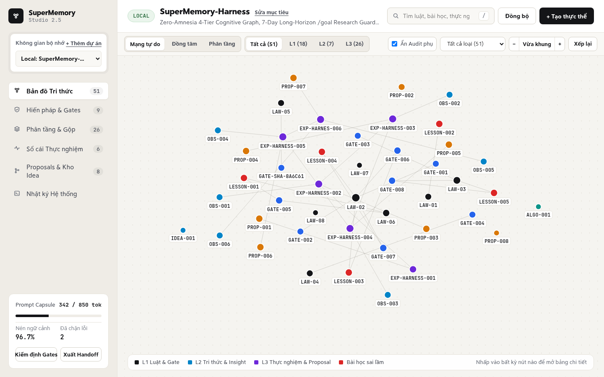
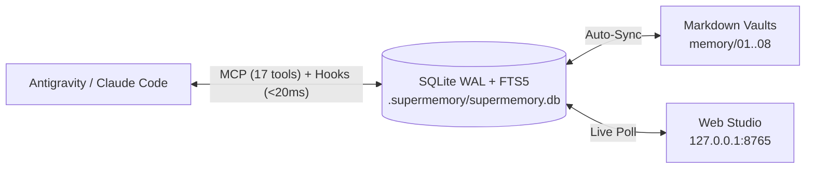

# SuperMemory

**[English](README.md)** · **[Tiếng Việt](README.vi.md)** · **[Changelog](CHANGELOG.md)**

Persistent SQLite + Markdown memory graph, research vault (`arXiv` / `Semantic Scholar` / `OpenAlex`), real-time `PreToolUse` code gates, and local Kanban web UI for **Antigravity CLI** and **Claude Code**. Pure Python `>= 3.10` (`0` third-party runtime dependencies).

| Kanban & Execution Progress | 200+ Node Knowledge Graph |
| :---: | :---: |
|  |  |
| **Bottleneck & SOTA Method Vault** | **Experiment Ledger & LaTeX Reader** |
|  |  |

---

## 1. Install

```bash
curl -fsSL https://raw.githubusercontent.com/vtnguyen04/research-supermemory/main/install.sh | bash
```

Or with `uv`:

```bash
uv tool install git+https://github.com/vtnguyen04/research-supermemory.git
supermemory install-plugin
```

`supermemory install-plugin` automatically configures both:
- **Antigravity CLI** (`~/.gemini/config/plugins/supermemory`)
- **Claude Code** (`~/.claude/settings.json` + `~/.claude.json` MCP server `supermemory_graph` + 9 skills + 8 subagents)

---

## 2. Quickstart

```bash
# 1. Initialize in any project
cd /path/to/project
supermemory init . --name "MyProject" --max-lines 500

# 2. Open the Web Studio (http://127.0.0.1:8765)
supermemory ui

# 3. Search memory across Local + Global + Sibling repos
supermemory recall "rollout drift" --siblings

# 4. Log a bottleneck and fetch SOTA papers into memory/07_METHOD_VAULT/
supermemory bottleneck diagnose --title "Long-horizon drift" --error-share 58 --ceiling-gain 0.09
supermemory scout search "model predictive control latent rollout" --bottleneck BNK-001 --save-top 2

# 5. Audit code gates or export a cross-agent handoff file
supermemory audit
supermemory handoff
```

---

## 3. Architecture & Storage



| Path | Purpose |
| :--- | :--- |
| `.supermemory/supermemory.db` | Local SQLite WAL + FTS5 graph, Kanban subtasks, DAG glob leases, and HTTP paper cache. |
| `~/.supermemory/global/` | Cross-project rules, lessons, and registered workspace index. |
| `memory/01_ACTIVE_STATE.md` | Current goal, phase, and top open bottlenecks (`< 150` lines). |
| `memory/02_CONSTITUTION_AND_LESSONS.md` | Project laws (`LAW-01`..`08`), deduplicated lessons, and active `CodeGates` (`< 200` lines). |
| `memory/04_PROPOSALS/` | OpenSpec proposals (`PROPOSED` -> `DESIGNED` -> `IMPLEMENTING` -> `AUDITED` -> `ARCHIVED`). |
| `memory/07_METHOD_VAULT/` | Distilled SOTA paper cards (`METH-XXX.md`). |
| `memory/08_BOTTLENECKS/` | Quantified failure slices (`BNK-XXX.md`) and research questions (`RQ-XXX`). |
| `AGENTS.md` / `CLAUDE.md` | Compact rule file (`< 400` tokens) read by Antigravity, Claude Code (`@AGENTS.md`), and Codex. |

---

## 4. CLI & MCP Summary

| CLI Command | Equivalent MCP Tool | Action |
| :--- | :--- | :--- |
| `supermemory init` | `init` | Bootstrap `.supermemory/`, 8 core Laws, default CodeGates, and `AGENTS.md` / `CLAUDE.md`. |
| `supermemory status` | `status` | Print the `< 850`-token session capsule and tier counts. |
| `supermemory recall "<q>"` | `recall` | Two-stage hybrid search (`compact=True` index -> `node_id` full view). |
| `supermemory bottleneck` | `diagnose_bottleneck` | Register/resolve Pareto error slices (`BNK-XXX`) and score Occam ROI. |
| `supermemory scout` | `scout_sota` | Query arXiv, Semantic Scholar & OpenAlex and save `METH-XXX` cards. |
| `supermemory proposal` / `idea` | `manage_proposal` / `propose_idea` | Create proposals, track Kanban checklists, or mark dead-end ideas. |
| `supermemory orchestrate` | `orchestrate` | Plan 3-wave multi-agent DAG sprints and claim glob-locked slices. |
| `supermemory exp` | `log_experiment` | Record single-variable experiments and compute baseline deltas. |
| `supermemory learn` / `gate` | `record_lesson` / `add_gate` | Save bug post-mortems and bind `PreToolUse` regex/AST/SHA-256 gates. |
| `supermemory checkpoint` | `checkpoint` | 1-call auto-sync: save insights (`OBS`), create/tick Kanban subtasks, and update `L0` state. |
| `supermemory audit` | `audit_gates` | Check all project files against active CodeGates. |
| `supermemory ui` | *(Skill: `/supermemory-ui`)* | Run local Kanban, Knowledge Graph & Research Web Studio (`127.0.0.1:8765`). |
