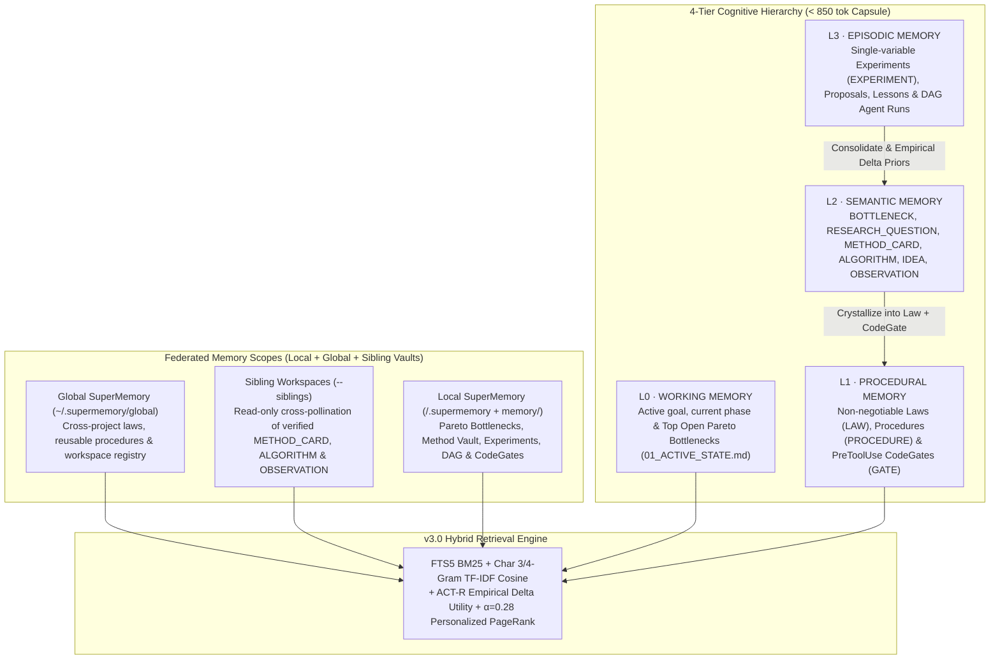
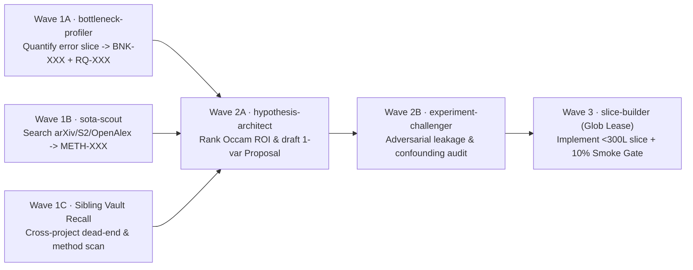
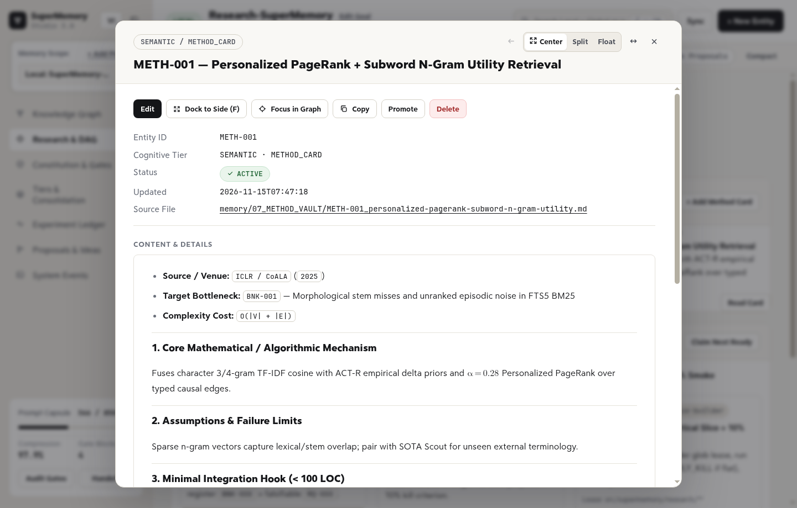
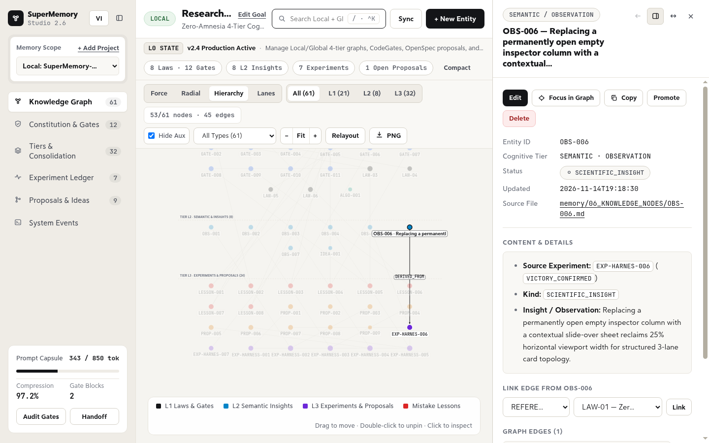
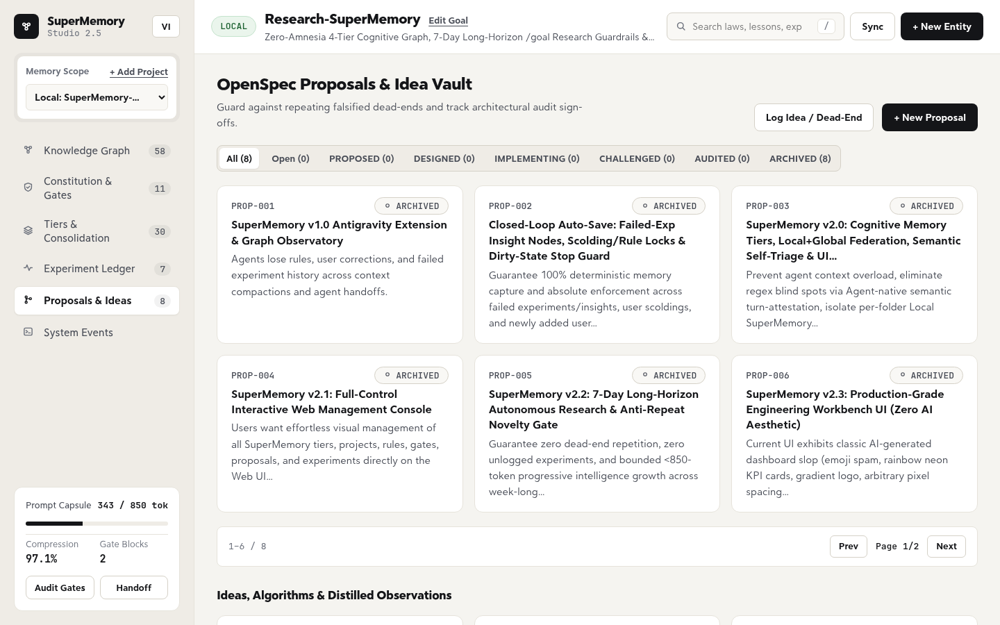

# Research SuperMemory (`v3.0`)

> Language: **English (Default)** | **[Tiếng Việt](README.vi.md)**

**Zero-Amnesia 4-Tier Cognitive Graph, Bottleneck-First Pareto Diagnostic Engine, Automated SOTA Literature & Method Scout (`arXiv` · `Semantic Scholar` · `OpenAlex`), Hybrid Subword TF-IDF + Empirical Utility PageRank, Multi-Agent 3-Wave Fast-DAG Orchestrator, Real-Time `PreToolUse` CodeGates, and Bilingual (`EN`/`VI`) Daylight Architectural Studio 3.0 — Native Antigravity CLI Plugin & Zero-Dependency Python SDK.**

---

## Table of Contents

1. [Problem Statement & Why `v3.0`](#1-problem-statement--why-v30)
2. [4-Tier Cognitive Architecture, Hybrid Utility PageRank & Sibling Vaults](#2-4-tier-cognitive-architecture-hybrid-utility-pagerank--sibling-vaults)
3. [Bottleneck-First Research Engine, SOTA Scout & Multi-Agent Fast-DAG](#3-bottleneck-first-research-engine-sota-scout--multi-agent-fast-dag)
4. [Daylight Architectural Studio `3.0` (`Web UI`)](#4-daylight-architectural-studio-30-web-ui)
5. [1-Command Installation (`Zero-Clone`)](#5-1-command-installation-zero-clone)
6. [End-to-End Quickstart & Research Workflows](#6-end-to-end-quickstart--research-workflows)
7. [Zero-Overhead Lifecycle Hooks & Self-Learning Loop](#7-zero-overhead-lifecycle-hooks--self-learning-loop)
8. [Complete CLI Reference (`supermemory`)](#8-complete-cli-reference-supermemory)
9. [17 MCP Tools, 4 Resources, 9 Skills & 8 Subagents](#9-17-mcp-tools-4-resources-9-skills--8-subagents)
10. [Repository Storage Layout & Git Sync Model](#10-repository-storage-layout--git-sync-model)
11. [Troubleshooting & Self-Audit Suite](#11-troubleshooting--self-audit-suite)

---

## 1. Problem Statement & Why `v3.0`

Modern AI Coding and Research Agents (Antigravity, Claude Code, Gemini CLI, Codex, Cursor) suffer from **five structural failure modes** during complex engineering and multi-day autonomous research:

1. **Context Compaction Amnesia:** Every `/compact` or new session drops architectural invariants, user preferences, and root causes of past regressions.
2. **Kitchen-Sink Ungrounded Ideation:** Left unchecked, agents propose bloated 500-line, multi-variable architectures before profiling which failure slice actually dominates validation error.
3. **Literature Blindness & Unstructured Paper Dumping:** Agents either hallucinate stale baselines or paste raw paper abstracts into context without distilling complexity costs, failure assumptions, or minimal integration hooks.
4. **Dead-End Repetition & Lexical Stem Misses:** Pure word-token search misses morphological variants and treats failed episodic noise equally with empirically validated SOTA insights.
5. **Multi-Agent File Collisions & Serial Bottlenecks:** Parallel agents overwrite each other's files or burn 100% compute budgets on flat ideas without an early-stop smoke gate.

**Research SuperMemory (`v3.0.0`)** solves all five using **100% pure Python 3.10+ standard library (`0` third-party dependencies, SQLite WAL + FTS5 + Hybrid Utility PageRank)**:

- **Git-Backed Dual Persistence:** Simultaneous sub-5ms **SQLite WAL Knowledge Graph** (`.supermemory/supermemory.db`) and deterministic **Git-tracked JSON/Markdown** (`memory/graph_snapshot.json`, `00_MEMORY_GRAPH.md`..`03_EXPERIMENTS_REGISTRY.md`, `07_METHOD_VAULT/`).
- **Bottleneck-First & Occam's Razor Gatekeeper:** Quantifies Pareto error slices (`BNK-XXX`) + falsifiable Research Questions (`RQ-XXX`) first, scores `Occam ROI`, and mechanically blocks multi-variable bloat or rebranded duplicate dead-end mechanisms.
- **Automated SOTA Scout + Cached Method Vault:** Queries **arXiv + Semantic Scholar + OpenAlex** with deterministic SQLite HTTP caching and distills papers into structured `METH-XXX` cards linked via `CANDIDATE_FOR -> BNK-XXX`.
- **3-Wave Multi-Agent Fast-DAG & Glob-Lease Bus:** Coordinates **8 specialized subagents** across parallel discovery, Occam red-team review, and `BEGIN IMMEDIATE` glob-locked vertical slices with a 10% Smoke Gate (`EARLY_KILLED` cascade).
- **Deterministic Mechanical Enforcement (`PreToolUse CodeGates < 20ms`):** Rejects (`"decision": "deny"`) violating file writes or shell commands before execution—with **0 extra LLM calls** on normal chat turns.

---

## 2. 4-Tier Cognitive Architecture, Hybrid Utility PageRank & Sibling Vaults

Inspired by **CoALA / ACT-R**, Research SuperMemory organizes knowledge across **4 cognitive tiers** and **Federated Scopes (`Local` + `Global` `~/.supermemory/global` + Read-Only `Sibling` Project Vaults)** while keeping the `SessionStart` prompt capsule under **`850 tokens`** (>95% context compression):



| Cognitive Tier | Entity Types | Context & Ranking Strategy |
| :--- | :--- | :--- |
| **`L0 · WORKING`** | `01_ACTIVE_STATE.md` (`< 150` lines) + Open `BOTTLENECK`s | Always injected at `SessionStart` so agents stay anchored on the top Pareto bottleneck. |
| **`L1 · PROCEDURAL`** | `LAW`, `PROCEDURE`, `GATE` (`< 200` lines) | Summarized in the active Capsule and synced to `AGENTS.md` / `GEMINI.md` / `CLAUDE.md`. |
| **`L2 · SEMANTIC`** | `BOTTLENECK`, `RESEARCH_QUESTION`, `METHOD_CARD`, `OBSERVATION`, `ALGORITHM`, `IDEA` | Ranked via **FTS5 BM25 + Subword 3/4-gram TF-IDF + Empirical Utility PageRank (`α = 0.28`)**. |
| **`L3 · EPISODIC`** | `EXPERIMENT`, `PROPOSAL`, `LESSON`, `AGENT_RUN` | Paginated on disk; surfaces instant `Anti-Repeat` & `Mechanism-Fingerprint` dead-end warnings. |

---

## 3. Bottleneck-First Research Engine, SOTA Scout & Multi-Agent Fast-DAG



1. **Pareto Bottleneck Diagnosis (`BNK-XXX` + `RQ-XXX`):** Ranks validation failure modes by `Pareto Priority = Error Share % × Ceiling Gain`, ensuring agents tackle the 80% error driver instead of cosmetic 2% edge cases.
2. **Occam's Razor ROI Gatekeeper:** Scores candidate proposals via:
   $$\text{Occam ROI} = \frac{\text{ErrorShare} \times \max(\text{CeilingGain}, 0.05)}{0.5 + 0.5\,\text{CoupledVars}^2 + \text{EstLOC}/120}$$
   When `strict_occam=True`, proposals lacking an open `BNK-XXX`, coupling $>1$ independent variable, or omitting a 10% smoke `kill_criterion` are deterministically rejected.
3. **Cached SOTA Literature & Method Vault (`07_METHOD_VAULT`):** Queries arXiv Atom, Semantic Scholar Graph, and OpenAlex APIs (cached in SQLite `http_cache` per `LAW-04`) and saves 5-field `METH-XXX` cards (*Core Mechanism*, *Complexity Cost*, *Assumptions & Failure Limits*, *Minimal Integration Hook*, *Target Bottleneck*).
4. **Glob-Lease Bus & 10% Smoke Early-Kill:** `BEGIN IMMEDIATE` SQLite transactions assign parallel `AgentTask` nodes without duplicate work, prevent overlapping `locked_globs` edits across concurrent `slice-builder` workers, and auto-cancel downstream tasks when a 10% smoke test reports `EARLY_KILLED`.

---

## 4. Daylight Architectural Studio `3.0` (`Web UI`)

A zero-CDN local management studio (`http://127.0.0.1:8765`) built with **Daylight Utilitarian Minimalism**, **English by default** with a 1-click **`VI` / `EN` toggle**, dedicated **`Research & DAG` Hub**, **Zero-CDN Scientific LaTeX Math & Markdown Renderer** (`$...$`, `$$...$$`, `\mathcal`, `\mathbb`, `\frac`, `\sqrt`), **3-Mode Expandable Inspector (`Center Modal` · `Split-Pane` · `Floating` via `F`)**, **`/` & `Ctrl+K` Federated Command Popover**, and verified `0px` horizontal overflow across Desktop (`1440x920`) and Mobile (`375x812`):

### Bottleneck-First Research Hub, SOTA Method Vault & 3-Wave Fast-DAG Board


### Center Modal Reader (`F` Shortcut) with Zero-CDN Scientific LaTeX Math Rendering


### 4-Mode Directed Knowledge Graph (`Force` · `Radial` · `Hierarchy` · `Lanes`) & Split-Pane Studio




### Paginated OpenSpec Proposals & Single-Variable Experiment Ledger



---

## 5. 1-Command Installation (`Zero-Clone`)

### Prerequisites
- OS: **Linux**, **macOS**, or **WSL2**.
- **Python `>= 3.10`** (zero external packages required).
- *(Optional)* `uv` or `pipx` and `agy` (Antigravity CLI) — automatically detected by the installer.

### Install or Upgrade in 1 Line (from any directory)

```bash
curl -fsSL https://raw.githubusercontent.com/vtnguyen04/research-supermemory/main/install.sh | bash
```

This single command automatically:
1. Installs the `supermemory` (and `research-supermemory`) CLI into `~/.local/bin/`.
2. Runs `supermemory install-plugin` to validate (`agy plugin validate --strict`) and register all **9 Skills · 8 Subagents · 1 Rule · 1 Lifecycle Hook · 1 MCP Server (`17` tools)** inside Antigravity CLI.

> **`PATH` Note:** If `~/.local/bin` is not yet on your `PATH`, add `export PATH="$HOME/.local/bin:$PATH"` to `~/.bashrc` or `~/.zshrc`.

### Alternative Installation Methods

```bash
# Direct 1-liner via uv:
uv tool install git+https://github.com/vtnguyen04/research-supermemory.git && ~/.local/bin/supermemory install-plugin

# Editable developer installation:
git clone https://github.com/vtnguyen04/research-supermemory.git
cd research-supermemory
uv tool install --editable . --force && supermemory install-plugin
```

---

## 6. End-to-End Quickstart & Research Workflows

### 6.1. Initialize a Project Workspace

```bash
cd /path/to/your-project
supermemory init . \
  --name "WorldModel-Research" \
  --max-lines 300 \
  --goal "Achieve reproducible SOTA on latent state prediction with zero test-set leakage"
```

### 6.2. Run the Bottleneck-First -> SOTA Scout -> 3-Wave Fast-DAG Loop

```bash
# 1. Quantify the dominant validation bottleneck & falsifiable Research Question first:
supermemory bottleneck diagnose \
  --title "Long-horizon rollout drift beyond 16 latent steps" \
  --error-share 58.0 \
  --ceiling-gain 0.09 \
  --metric "val_f1" \
  --evidence-slice " trajectories with >16 steps account for 58% of total regret" \
  --rq "Does a stop-grad consistency predictor cut >16-step drift by >=25% at <5% compute cost?" \
  --kill-criterion "Abort at 10% smoke slice if 16-step MSE improves < 3%" \
  --smoke-cmd "pytest -q tests/test_rollout_smoke.py"

# 2. Scout latest papers from arXiv + Semantic Scholar + OpenAlex and mint Method Cards:
supermemory scout search "latent rollout consistency model predictive control" \
  --bottleneck BNK-001 \
  --min-year 2024 \
  --save-top 2

# 3. Cross-pollinate verified methods & dead-ends across Local + Global + Sibling workspaces:
supermemory recall "stop-grad latent rollout drift" --siblings

# 4. Plan and claim tasks on the 3-Wave Multi-Agent Fast-DAG:
supermemory orchestrate plan \
  --goal "Resolve BNK-001 long-horizon rollout drift with highest Occam ROI" \
  --bottleneck BNK-001 \
  --globs "src/models/**" \
  --smoke-cmd "pytest -q tests/test_rollout_smoke.py"

supermemory orchestrate claim --agent slice-builder
```

### 6.3. Launch Daylight Architectural Studio `3.0` (`Local` & `Global`)

```bash
supermemory ui --port 8765      # Open current project workspace
supermemory ui --global         # Or open Global SuperMemory from anywhere
```

### 6.4. Natural-Language Self-Learning, Evaluator Freeze & Single-Variable Experiments

```bash
# Crystallize a post-mortem lesson + PreToolUse regex CodeGate:
supermemory learn \
  --title "Ban fixed 5+ column CSS grids causing viewport clipping" \
  --mistake "Used repeat(6, minmax(14.5rem, 1fr)) which clipped rightmost column on 1440px" \
  --root-cause "Total min-width exceeded center viewport" \
  --rule "Always use auto-fill with paginated lists" \
  --law LAW-03 \
  --forbid-regex "repeat\(\s*[5-9]\s*,\s*minmax\(" \
  --target-glob "src/**/*.css"

# Freeze benchmark/evaluator integrity via SHA-256:
supermemory gate freeze scripts/evaluate_benchmark.py --law LAW-05

# Log a single-variable experiment (auto-computes delta & extracts L2 Observations):
supermemory exp \
  --track "world-model" \
  --title "SimSiam Stop-Grad Latent Consistency Loss" \
  --hypothesis "Stop-grad prevents representation collapse without an EMA target encoder" \
  --diff "Replaced direct MSE with cosine stop-grad loss in loss.py" \
  --cv-score 0.8420 --cv "5-fold mean F1 = 0.8420" \
  --verdict KEEP \
  --insight "Cosine stop-grad stabilized latent norm from epoch 3 and cut VRAM by 18% vs EMA"
```

---

## 7. Zero-Overhead Lifecycle Hooks & Self-Learning Loop

| Hook Event | Latency Budget | Exact `v3.0` Runtime Behavior |
| :--- | :--- | :--- |
| **`SessionStart`** | `< 30ms` | Injects the 4-tier federated Capsule (`L0 + L1` + Top Open `BOTTLENECK`s `< 850` tokens) plus `HANDOFF_BRIEFING.md` recovery after `/compact`. |
| **`PreInvocation`** | `< 15ms` | **100% silent (`{}`)** on normal Q&A and short prompts. Injects context strictly on explicit user rules, high-confidence `Anti-Repeat` matches, or `/goal` heartbeat intervals. |
| **`PreToolUse`** | `< 20ms` | Deterministically validates `write_file`, `edit_file`, and `run_command` against **6 mechanical gate types**: `MAX_LINES`, `FORBIDDEN_FILENAME`, `AST_SYNTAX`, `FORBIDDEN_CMD_PATTERN`, `FORBIDDEN_REGEX`, and `FROZEN_SHA256`. |
| **`PostToolUse`** | `< 15ms` | Tracks unlogged benchmark runs and clears attestation locks as soon as `supermemory_record_lesson` or `supermemory_log_experiment` runs. |
| **`Stop`** | `< 10ms` | Allows immediate turn completion (`0` extra turns) on normal chat; holds strictly when an explicit rule or completed benchmark has not yet been persisted. |

---

## 8. Complete CLI Reference (`supermemory`)

| Command | Key Subcommands / Flags | Description |
| :--- | :--- | :--- |
| `supermemory init [dir]` | `--name`, `--max-lines`, `--goal` | Initialize Local SuperMemory, 8 Constitutional Laws, 4 default CodeGates, and agent rule files. |
| `supermemory status` | `-w <dir>`, `-g` (`--global`) | Show the 4-tier cognitive Capsule, open Pareto bottlenecks, and token telemetry. |
| `supermemory workspaces` | *(none)* | List Global SuperMemory and all registered Local project workspaces. |
| `supermemory recall "<query>"` | `--siblings`, `--limit`, `--hops`, `-w`, `-g` | Federated `LOCAL + GLOBAL (+ SIBLINGS)` Hybrid BM25 + Subword TF-IDF + Utility PageRank recall. |
| `supermemory bottleneck` | `diagnose`, `list`, `resolve <BNK_ID>` | Quantify Pareto error slices (`BNK-XXX`), mint falsifiable `RQ-XXX`, and manage bottleneck status. |
| `supermemory scout` | `search "<query>"`, `card` | Search **arXiv + Semantic Scholar + OpenAlex** (SQLite cached) and mint `METH-XXX` Method Cards. |
| `supermemory orchestrate` | `plan`, `status`, `claim`, `complete` | Plan 3-Wave Multi-Agent Fast-DAG sprints, claim dependency-ready tasks, and manage glob leases. |
| `supermemory learn` | `--title`, `--mistake`, `--root-cause`, `--rule`, `--forbid-regex`, `-g` | Crystallize a bug post-mortem or user rule into `LESSON` + `LAW` + `CodeGate`. |
| `supermemory consolidate` | `--ids A,B` or `--auto`, `--tier`, `-g` | Distill scattered `L3` episodes into `L2` semantic insights or `L1` procedural rules. |
| `supermemory promote <ID>` | `-w <dir>` | Promote a local Law, Method Card, Algorithm, or Procedure to Global SuperMemory. |
| `supermemory gate` | `list`, `add`, `freeze <file>` | Manage `PreToolUse` CodeGates and cryptographic `SHA-256` evaluator locks. |
| `supermemory idea` | `--title`, `--summary`, `--bottleneck`, `--strict-occam` | Record an `IDEA` / `ALGORITHM` (scored by Occam ROI) or log a `REJECTED` dead-end. |
| `supermemory proposal` | `create`, `advance <ID> <STAGE>` | Manage OpenSpec Proposals with Occam ROI & Mechanism-Fingerprint anti-repeat checks. |
| `supermemory exp` | `--track`, `--title`, `--hypothesis`, `--diff`, `--verdict` | Log a single-variable experiment, compute baseline delta, and extract `L2` observations. |
| `supermemory audit` | `-w <dir>` | Scan all workspace files against every enabled `CodeGate` (CI-ready exit codes). |
| `supermemory sync` / `handoff` | `-w <dir>` | Re-export SQLite graph to Markdown / `graph_snapshot.json` or build `HANDOFF_BRIEFING.md`. |
| `supermemory ui` | `-w <dir>`, `-g`, `--host`, `--port` | Launch **Daylight Architectural Studio `3.0`** web server. |
| `supermemory install-plugin` | `--validate-only` | Validate (`--strict`) and install/update the native Antigravity CLI plugin. |

---

## 9. 17 MCP Tools, 4 Resources, 9 Skills & 8 Subagents

### 9.1. 17 Native Stdio MCP Tools (`mcp_config.json`)
1. `supermemory_init` — Initialize a new Local SuperMemory workspace.
2. `supermemory_status` — Inspect the 4-tier Capsule, open bottlenecks, and token budget.
3. `supermemory_recall` — Federated Hybrid Subword TF-IDF + Empirical Utility PageRank recall (`include_siblings` supported).
4. `supermemory_diagnose_bottleneck` — Register/rank/resolve Pareto `BNK-XXX` bottlenecks, `RQ-XXX` questions, and score `Occam ROI`.
5. `supermemory_scout_sota` — Search arXiv, Semantic Scholar & OpenAlex (SQLite cached) and mint `METH-XXX` cards into `07_METHOD_VAULT`.
6. `supermemory_orchestrate` — Plan 3-Wave Multi-Agent Fast-DAG sprints, atomically claim tasks with glob-lease locks, and trigger 10% `EARLY_KILLED` cascades.
7. `supermemory_record_lesson` — Persist user rules or bug post-mortems with `CodeGate` binding.
8. `supermemory_add_gate` — Add a `PreToolUse` CodeGate or `FROZEN_SHA256` lock.
9. `supermemory_propose_idea` — Record an `IDEA` / `ALGORITHM` with Occam ROI scoring or mark a `REJECTED` dead-end.
10. `supermemory_manage_proposal` — Create and advance OpenSpec Proposals with Occam & novelty gates.
11. `supermemory_log_experiment` — Log single-variable scientific experiments and auto-extract `OBSERVATION` nodes.
12. `supermemory_update_state` — Update `L0` active goal, phase, and next actions.
13. `supermemory_link_knowledge` — Upsert custom knowledge nodes and directed graph edges.
14. `supermemory_consolidate` — Distill `L3` episodes into `L2` semantic or `L1` procedural nodes.
15. `supermemory_checkpoint` — Attest turn-level memory status.
16. `supermemory_audit_gates` — Run full workspace CodeGate verification.
17. `supermemory_record_audit` — Record `experiment-challenger` or `victory-auditor` sign-off on a Proposal.

**4 Fast-Read MCP Resources:** `supermemory://active_state`, `supermemory://constitution`, `supermemory://experiments`, `supermemory://memory_graph`.

### 9.2. 9 Slash Skills & 8 Specialized Subagents
- **9 Skills:** `supermemory-init`, `supermemory-research`, `supermemory-orchestrate`, `supermemory-learn`, `supermemory-propose`, `supermemory-experiment`, `supermemory-audit`, `supermemory-handoff`, `supermemory-ui`.
- **8 Subagents:**
  - `bottleneck-profiler`: Decomposes validation error/regret by slice and mints Pareto `BNK-XXX` + falsifiable `RQ-XXX` nodes before ideation.
  - `sota-scout`: Harvests relevant SOTA papers from arXiv / Semantic Scholar / OpenAlex into `07_METHOD_VAULT/METH-XXX.md`.
  - `hypothesis-architect`: Synthesizes `BNK-XXX` + `METH-XXX` into high-Occam-ROI, single-variable OpenSpec proposals with 10% smoke kill criteria.
  - `slice-builder`: Claims glob-locked vertical implementation slices (`< 300`L), runs the 10% Smoke Gate first (`EARLY_KILLED` if flat), and logs experiments.
  - `experiment-challenger`: Adversarial red-team reviewer hunting data leakage, multi-variable confounding, and rebranded dead-end mechanisms.
  - `victory-auditor`: Independent auditor verifying metric deltas, `FROZEN_SHA256` evaluator integrity, and test suites before archiving proposals.
  - `root-cause-investigator`: 5-Whys debugger isolating structural root causes and binding `PreToolUse` CodeGates.
  - `memory-curator`: Knowledge graph hygiene auditor keeping `01_ACTIVE_STATE.md` (`< 150`L) and `02_CONSTITUTION_AND_LESSONS.md` (`< 200`L) compact.

---

## 10. Repository Storage Layout & Git Sync Model

```text
<project-root>/
├── .supermemory/
│   ├── supermemory.db          # [Git Ignored] SQLite WAL + FTS5 + HTTP Cache + Agent DAG (auto-rebuilt)
│   └── runtime/                # [Git Ignored] Ephemeral hook session state
├── memory/                     # [Git Tracked in Private Team Repos] Multi-agent source of truth
│   ├── graph_snapshot.json     # Full graph + Gates + Experiments + DAG Tasks snapshot for 100% rebuild
│   ├── 00_MEMORY_GRAPH.md      # Knowledge graph topology, Bottlenecks & Method Vault index
│   ├── 01_ACTIVE_STATE.md      # L0 Working Memory + Top Open Pareto Bottlenecks (< 150 lines)
│   ├── 02_CONSTITUTION_AND_LESSONS.md # L1 Constitution & CodeGates (< 200 lines)
│   ├── 03_EXPERIMENTS_REGISTRY.md     # Single-variable experiment leaderboard
│   ├── HANDOFF_BRIEFING.md     # Compaction-proof handoff briefing
│   ├── lessons/                # Post-mortem records (LESSON-*.md)
│   ├── experiments/            # Per-experiment scientific logs (EXP-*.md)
│   ├── 04_PROPOSALS/           # OpenSpec artifacts (proposal.md, design.md, tasks.md)
│   ├── 05_IDEAS_AND_ALGORITHMS/# Ideas, algorithms & falsified dead-ends
│   ├── 06_KNOWLEDGE_NODES/     # Bottlenecks (BNK-*), RQs (RQ-*) & Observations (OBS-*)
│   └── 07_METHOD_VAULT/        # Curated SOTA Method Cards (METH-*.md)
├── .agents/
│   ├── rules/00_supermemory_constitution.md
│   └── hooks.json
└── AGENTS.md / GEMINI.md / CLAUDE.md
```

> **Public vs. Private Repositories:** Keep `memory/` tracked in **private team repositories** so collaborators and multiple agents share the same verified graph. When publishing a **public open-source package**, keep `.supermemory/`, `memory/`, `.agents/`, `/AGENTS.md`, `/CLAUDE.md`, and `/GEMINI.md` in `.gitignore` so personal workspace memory remains strictly local.

---

## 11. Troubleshooting & Self-Audit Suite

```bash
# Restart Studio 3.0 if port 8765 is busy:
fuser -k 8765/tcp 2>/dev/null; supermemory ui --port 8765

# Run the Full Verification & Constitutional Self-Audit Suite:
pytest -v
ruff check src tests
mypy src
supermemory install-plugin --validate-only
supermemory audit
```

---

## License

Released under the **MIT License**.
