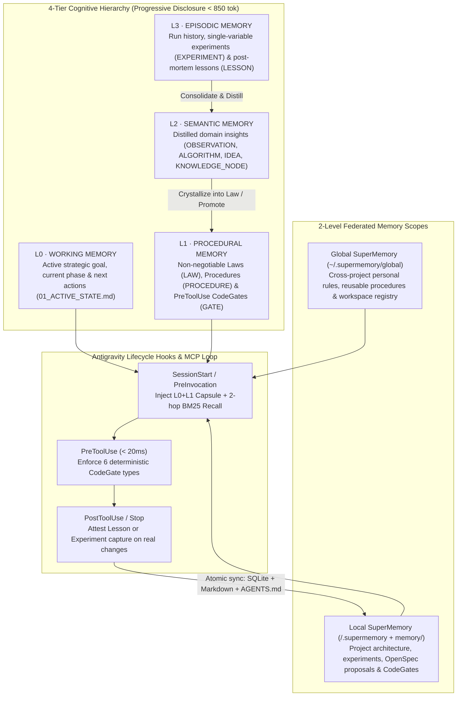
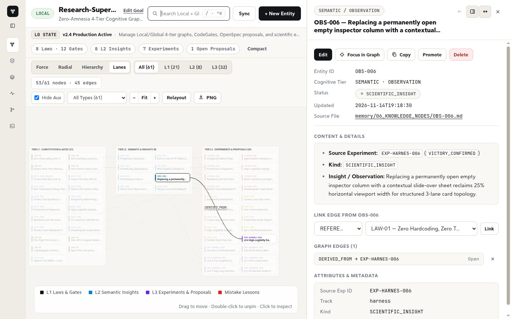
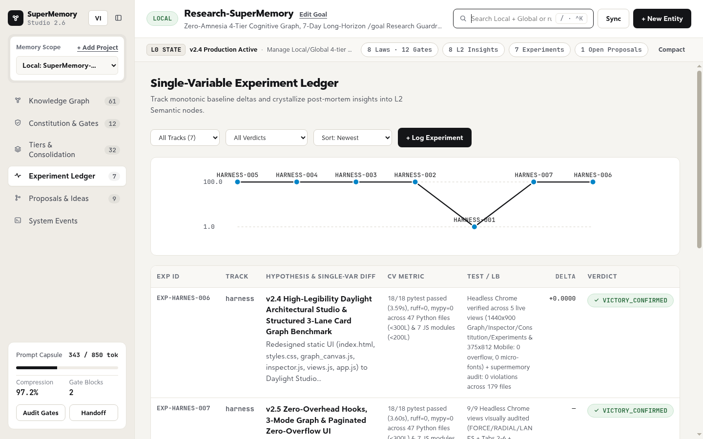

# Research SuperMemory (`v2.6`)

> Language: **English (Default)** | **[Tiếng Việt](README.vi.md)**

**Zero-Amnesia 4-Tier Cognitive Graph, Real-Time Constitutional `PreToolUse` CodeGates, Self-Learning Lesson-to-Gate Crystallization, Single-Variable Scientific Experiment Ledger, OpenSpec Lifecycle Governance, and Bilingual (`EN`/`VI`) Daylight Architectural Studio — Native Antigravity CLI Plugin & Zero-Dependency Python SDK.**

---

## Table of Contents

1. [Problem Statement & Motivation](#1-problem-statement--motivation)
2. [4-Tier Cognitive Architecture & Local + Global Federation](#2-4-tier-cognitive-architecture--local--global-federation)
3. [Daylight Architectural Studio (`Web UI`)](#3-daylight-architectural-studio-web-ui)
4. [1-Command Installation (`Zero-Clone`)](#4-1-command-installation-zero-clone)
5. [End-to-End Quickstart & Workflows](#5-end-to-end-quickstart--workflows)
6. [Zero-Overhead Lifecycle Hooks & Self-Learning Loop](#6-zero-overhead-lifecycle-hooks--self-learning-loop)
7. [Complete CLI Reference (`supermemory`)](#7-complete-cli-reference-supermemory)
8. [14 MCP Tools, 4 Resources, 7 Skills & 4 Subagents](#8-14-mcp-tools-4-resources-7-skills--4-subagents)
9. [Repository Storage Layout & Git Sync Model](#9-repository-storage-layout--git-sync-model)
10. [Troubleshooting & Self-Audit Suite](#10-troubleshooting--self-audit-suite)

---

## 1. Problem Statement & Motivation

Modern AI Coding and Research Agents (Antigravity, Claude Code, Gemini CLI, Codex, Cursor) suffer from **three structural failure modes** during complex engineering or multi-day autonomous research:

1. **Context Compaction Amnesia:** Every `/compact` or new session drops critical architectural invariants, user preferences, and hard-won root causes of past regressions.
2. **Dead-End Repetition:** During long-horizon autonomous `/goal` runs, agents repeatedly revisit falsified hypotheses, dead-end hyperparameters, or multi-variable edits that confound attribution.
3. **Unenforced Markdown Bloat:** Flat `.md` memory files balloon until they blow up the context budget—and passive prose cannot deterministically block a bad edit before it hits disk.

**Research SuperMemory (`v2.5`)** solves all three using **100% pure Python 3.10+ standard library (`0` third-party dependencies, SQLite WAL + FTS5 BM25)**:

- **Git-Backed Dual Persistence:** Every entity lives simultaneously in a sub-5ms **SQLite FTS5 Knowledge Graph** (`.supermemory/supermemory.db`) and deterministic **Git-tracked JSON/Markdown** (`memory/graph_snapshot.json`, `00_MEMORY_GRAPH.md`, `01_ACTIVE_STATE.md`, `02_CONSTITUTION_AND_LESSONS.md`, `03_EXPERIMENTS_REGISTRY.md`). Cloning on a fresh machine automatically reconstructs 100% of the SQLite graph from `graph_snapshot.json`.
- **Deterministic Mechanical Enforcement (`PreToolUse CodeGates < 20ms`):** Lessons do not sit idle in prose—they bind directly to `PreToolUse` gates that immediately reject (`"decision": "deny"`) violating file writes or shell commands before execution.
- **Zero-Overhead Conversational Turns:** Normal Q&A, code reading, and casual clarifications incur **0 extra LLM tool calls**; enforcement locks engage strictly when user rules are declared, real bugs are fixed, or scientific benchmarks run.

---

## 2. 4-Tier Cognitive Architecture & Local + Global Federation

Inspired by **CoALA / ACT-R** cognitive architectures, Research SuperMemory organizes knowledge across **4 memory tiers** combined with **2-level Federation (`Local` per-repository + `Global` machine-wide at `~/.supermemory/global`)**, keeping the session-start capsule under **`850 tokens`** (>95% context compression):



| Cognitive Tier | Entity Types | Context Injection Strategy |
| :--- | :--- | :--- |
| **`L0 · WORKING`** | `01_ACTIVE_STATE.md` (`< 150` lines) | Always loaded at `SessionStart` to preserve strategic goals and immediate next steps. |
| **`L1 · PROCEDURAL`** | `LAW`, `PROCEDURE`, `GATE` (`< 200` lines) | Summarized in the active Capsule and synced to `AGENTS.md` / `GEMINI.md` / `CLAUDE.md`. |
| **`L2 · SEMANTIC`** | `OBSERVATION`, `ALGORITHM`, `IDEA`, `KNOWLEDGE_NODE` | Retrieved on demand via **SQLite FTS5 BM25 + 2-hop graph neighborhood expansion**. |
| **`L3 · EPISODIC`** | `EXPERIMENT`, `PROPOSAL`, `LESSON`, `AGENT_RUN` | Stored paginated on disk; surfaces instant `Anti-Repeat` warnings on dead-ends and consolidates into `L2`/`L1`. |

---

## 3. Daylight Architectural Studio (`Web UI v2.6`)

A zero-CDN local management studio (`http://127.0.0.1:8765`) built with **Daylight Utilitarian Minimalism**, **English by default** with a 1-click **`VI` / `EN` language toggle**, **Docked Split-Pane vs Floating Inspector** (`←` Back history, Wide mode, 1-click `Focus in Graph`, `Copy MD`, Edge Unlink `×`, and full untruncated CodeGate regex inspection), **`/` & `Ctrl+K` Federated Command Popover**, collapsible sidebar rail, live L0 Working Memory strip, and zero horizontal overflow on Desktop (`1440x900`) and Mobile (`375x812`):

### 4-Mode Directed Knowledge Graph (`Force` · `Radial` · `Hierarchy` · `Lanes`) & Split-Pane Studio




### Paginated OpenSpec Proposals & Single-Variable Experiment Ledger




---

## 4. 1-Command Installation (`Zero-Clone`)

### Prerequisites
- OS: **Linux**, **macOS**, or **WSL2**.
- **Python `>= 3.10`** (zero external packages required).
- *(Optional)* `uv` or `pipx` and `agy` (Antigravity CLI) — automatically detected by the installer.

### Install or Upgrade in 1 Line (from any directory)

```bash
curl -fsSL https://raw.githubusercontent.com/vtnguyen04/research-supermemory/main/install.sh | bash
```

This single command automatically:
1. Installs the `supermemory` (and `research-supermemory`) CLI into `~/.local/bin/` (preferring `uv tool` -> `pipx` -> or an isolated `~/.local/share/supermemory-venv` fallback when only stock `python3` is available).
2. Runs `supermemory install-plugin` to validate (`agy plugin validate --strict`) and register all **7 Skills · 4 Subagents · 1 Rule · 1 Lifecycle Hook · 1 MCP Server** inside Antigravity CLI.

> **`PATH` Note:** If `~/.local/bin` is not yet on your `PATH`, add this line to `~/.bashrc` or `~/.zshrc`:
> ```bash
> export PATH="$HOME/.local/bin:$PATH"
> ```

### Alternative Installation Methods

```bash
# Direct 1-liner via uv:
uv tool install git+https://github.com/vtnguyen04/research-supermemory.git && ~/.local/bin/supermemory install-plugin

# Editable developer installation:
git clone https://github.com/vtnguyen04/research-supermemory.git
cd research-supermemory
uv tool install --editable . --force && supermemory install-plugin
```

### Uninstall

```bash
agy plugin uninstall supermemory
uv tool uninstall research-supermemory   # or: rm -rf ~/.local/share/supermemory-venv ~/.local/bin/supermemory ~/.local/bin/research-supermemory
```

---

## 5. End-to-End Quickstart & Workflows

### 5.1. Initialize a Project Workspace (or Use Global-Only Mode)

You can operate in two modes:
- **Zero-Init Global Mode:** Without running `init`, agents automatically use **Global SuperMemory** (`~/.supermemory/global`) without writing any files into the current repository.
- **Project-Scoped Local SuperMemory:**

```bash
cd /path/to/your-project
supermemory init . \
  --name "WorldModel-Research" \
  --max-lines 300 \
  --goal "Achieve reproducible SOTA on latent state prediction with zero test-set leakage"
```

`supermemory init` creates `.supermemory/supermemory.db`, `memory/`, 8 canonical Constitutional Laws (`LAW-01`..`LAW-08`), 4 default CodeGates (`GATE-001`..`GATE-004`), and synchronized agent rules (`AGENTS.md`, `GEMINI.md`, `CLAUDE.md`, `.agents/`).

### 5.2. Launch the Daylight Architectural Studio (`Local` & `Global`)

```bash
# Inside an initialized project directory:
supermemory ui --port 8765

# Or from ANY directory on your machine to open Global SuperMemory directly:
supermemory ui --global
# (shorthand: supermemory ui -g)
```

Inside `http://127.0.0.1:8765`:
- **Bilingual `EN` / `VI` Switcher:** Defaults to **English (`EN`)**; click **`VI`** in the top-left brand header at any time to switch the entire studio to Vietnamese (persisted in `localStorage`, or pass `?lang=en` / `?lang=vi`).
- **Instant Workspace Switching:** Use the **Memory Workspace** selector in the left sidebar to switch between `Global: All Workspaces` and any registered `Local` project without restarting the server (or click `+ Add Workspace`).
- **3 Graph Layout Modes:** Switch seamlessly between **`Force`** (`FORCE` default network), **`Radial`** (`RADIAL` concentric `L1`/`L2`/`L3` rings), and **`Lanes`** (`LANES` 3-column architectural cards); click any node to open the **Slide-Over Inspector** to edit, link edges, delete, or **Promote to Global**.
- **Cognitive Consolidation (`Tiers & Consolidate`):** Select scattered `L3` episodes and distill them into `L2 Semantic` insights or `L1 Procedural` rules (or click **Auto-Consolidate Clusters**).
- **Keyboard Shortcuts:** Press `/` to focus federated BM25 search, `Esc` to close the inspector/dialog, and `+` / `-` / `0` on the graph canvas to zoom or fit.

### 5.3. Natural-Language Rule & Lesson Capture

You never have to leave chat to teach the agent permanent rules:
- *"Save rule to global: always write Google-style docstrings and never use the walrus operator in Python."* -> The agent calls `supermemory_record_lesson(scope="global")` and updates Global Laws.
- *"Every time you edit the UI, capture headless screenshots across all tabs to verify zero overflow, record this as a lesson, and bind a CodeGate."* -> Crystallizes into a `LESSON` + `LAW` + `PreToolUse` `CodeGate`.

Or record directly via CLI:

```bash
# Record a project-local lesson + PreToolUse regex gate:
supermemory learn \
  --title "Ban fixed 5+ column CSS grids causing viewport clipping" \
  --mistake "Used repeat(6, minmax(14.5rem, 1fr)) which clipped rightmost column on 1440px" \
  --root-cause "Total min-width exceeded center viewport" \
  --rule "Always use auto-fill with paginated lists" \
  --law LAW-03 \
  --forbid-regex "repeat\(\s*[5-9]\s*,\s*minmax\(" \
  --target-glob "src/**/*.css"

# Pass -g (--global) to enforce across ALL projects on your machine:
supermemory learn -g --title "..." --mistake "..." --root-cause "..." --rule "..."
```

### 5.4. Cryptographic Evaluator Freeze (`SHA-256`) & Scientific Experiments

```bash
# 1. Freeze benchmark/evaluator integrity so agents can never tamper with scoring:
supermemory gate freeze scripts/evaluate_benchmark.py --law LAW-05

# 2. Record a falsified Dead-End so future sessions never repeat it:
supermemory idea \
  --title "Heavy synchronous dense embeddings inside PreToolUse" \
  --summary "Increased file-edit hook latency to >1.8s" \
  --status REJECTED \
  --reject-reason "Violated <20ms PreToolUse hook latency budget"

# 3. Draft an OpenSpec Proposal before major architectural changes:
supermemory proposal create \
  --title "Multi-step latent rollout predictor" \
  --why "Reduce compounding drift beyond 16 rollout steps" \
  --changes "Add latent_rollout.py (<200 lines) and unit tests"

# 4. Log a single-variable experiment (auto-computes baseline delta & extracts L2 Observations):
supermemory exp \
  --track "world-model" \
  --title "SimSiam Stop-Grad Latent Consistency Loss" \
  --hypothesis "Stop-grad prevents representation collapse without an EMA target encoder" \
  --diff "Replaced direct MSE with cosine stop-grad loss in loss.py" \
  --cv-score 0.8420 --cv "5-fold mean F1 = 0.8420" \
  --verdict KEEP \
  --insight "Cosine stop-grad stabilized latent norm from epoch 3 and cut VRAM by 18% vs EMA"
```

> **Failed-Experiment Post-Mortem Enforcement:** Whenever `--verdict` is `FAILED` or `REVERT`, SuperMemory **requires** a non-empty `--post-mortem` or `--insight`. Extracted insights automatically become `L2 OBSERVATION` nodes so future recalls surface `SUPERMEMORY ANTI-REPEAT` warnings.

### 5.5. Compaction-Proof Handoff Across Sessions & Agents

```bash
supermemory handoff
```

Generates `memory/HANDOFF_BRIEFING.md` containing the active Capsule, enforced CodeGates, recent anti-repeat traps, and latest experiment deltas—enabling zero-loss continuation after `/compact` or when switching between Antigravity, Claude Code, Codex, and Gemini CLI.

---

## 6. Zero-Overhead Lifecycle Hooks & Self-Learning Loop

| Hook Event | Latency Budget | Exact `v2.5` Runtime Behavior |
| :--- | :--- | :--- |
| **`SessionStart`** | `< 30ms` | Injects the 4-tier federated Capsule (`L0 + L1` Local + Global `< 850` tokens). Automatically attaches recovery context from `HANDOFF_BRIEFING.md` after `/compact`. |
| **`PreInvocation`** | `< 15ms` | **100% silent (`{}`)** on normal Q&A and short prompts for zero token overhead. Injects context strictly on: (1) explicit user rules/corrections, (2) high-confidence `Anti-Repeat` matches (`BM25 >= 8.5`), or (3) autonomous `/goal` heartbeat intervals (every 15 steps). |
| **`PreToolUse`** | `< 20ms` | Deterministically validates `write_file`, `edit_file`, and `run_command` against **6 mechanical gate types**: `MAX_LINES`, `FORBIDDEN_FILENAME`, `AST_SYNTAX`, `FORBIDDEN_CMD_PATTERN`, `FORBIDDEN_REGEX`, and `FROZEN_SHA256`. |
| **`PostToolUse`** | `< 15ms` | Tracks unlogged benchmark runs and clears pending attestation locks immediately when `supermemory_record_lesson` or `supermemory_log_experiment` executes. |
| **`Stop`** | `< 10ms` | Allows immediate turn completion (`0` extra turns) on normal chat; holds the turn strictly when an explicit rule lesson or completed benchmark run has not yet been persisted. |

---

## 7. Complete CLI Reference (`supermemory`)

| Command | Key Flags | Description |
| :--- | :--- | :--- |
| `supermemory init [dir]` | `--name`, `--max-lines`, `--goal` | Initialize Local SuperMemory, 8 Constitutional Laws, 4 default CodeGates, and `AGENTS.md` / `GEMINI.md` / `CLAUDE.md`. |
| `supermemory status` | `-w <dir>`, `-g` (`--global`) | Show the 4-tier cognitive Capsule, token budget telemetry, and graph counts (`Local` or `Global`). |
| `supermemory workspaces` | *(none)* | List Global SuperMemory (`~/.supermemory/global`) and all registered Local project workspaces. |
| `supermemory recall "<query>"` | `--limit`, `--hops`, `-w`, `-g` | Federated `LOCAL + GLOBAL` SQLite FTS5 BM25 search + 2-hop graph expansion + dead-end anti-repeat warnings. |
| `supermemory learn` | `--title`, `--mistake`, `--root-cause`, `--rule`, `--law`, `--forbid-regex`, `--target-glob`, `--forbid-cmd-regex`, `-g` | Crystallize a bug post-mortem or user rule into `LESSON` + `LAW` + `CodeGate` (`Local` or `Global`). |
| `supermemory consolidate` | `--ids A,B` or `--auto`, `--tier SEMANTIC\|PROCEDURAL`, `-g` | Distill scattered `L3` episodes into `L2` semantic insights or `L1` procedural rules. |
| `supermemory promote <NODE_ID>` | `-w <dir>` | Promote a high-value local Law, Lesson, Algorithm, or Procedure to Global SuperMemory. |
| `supermemory gate list` | `-w <dir>` | List all configured `PreToolUse` CodeGates and blocked-regression counters. |
| `supermemory gate add` | `--type`, `--name`, `--law`, `--glob`, `--pattern` | Register a new source-code or shell-command `PreToolUse` gate. |
| `supermemory gate freeze <file>` | `--law LAW-05`, `-w <dir>` | Lock cryptographic `SHA-256` integrity on an evaluator or baseline artifact. |
| `supermemory idea` | `--title`, `--summary`, `--status`, `--reject-reason`, `--algorithm` | Record a new `IDEA` / `ALGORITHM` or log a falsified `REJECTED` dead-end. |
| `supermemory proposal create\|advance` | `--title`, `--why`, `--changes` / `<ID> <STAGE>` | Create or advance OpenSpec Proposals (`PROPOSED` -> `DESIGNED` -> `IMPLEMENTING` -> `CHALLENGED` -> `AUDITED` -> `ARCHIVED`). |
| `supermemory exp` | `--track`, `--title`, `--hypothesis`, `--diff`, `--cv-score`, `--test-score`, `--verdict`, `--post-mortem`, `--insight` | Log a single-variable experiment, compute baseline delta, and extract `L2` observations. |
| `supermemory audit` | `-w <dir>` | Scan all workspace files against every enabled `CodeGate` (non-zero exit code on violations for CI). |
| `supermemory sync` | `-w <dir>` | Re-export SQLite graph state to deterministic Markdown files, `graph_snapshot.json`, and `AGENTS.md`. |
| `supermemory handoff` | `-w <dir>` | Generate `memory/HANDOFF_BRIEFING.md` prior to `/compact` or cross-agent handoff. |
| `supermemory checkpoint` | `--status CLEAN\|CAPTURED`, `-g` | Attest end-of-turn memory hygiene status. |
| `supermemory ui` | `-w <dir>`, `-g` (`--global`), `--host`, `--port` | Launch the **Daylight Architectural Studio** web server (auto-falls back to Global outside initialized repos). |
| `supermemory install-plugin` | `--validate-only` | Validate (`--strict`) and install/update the native Antigravity CLI plugin. |
| `supermemory import-zaloai <src>` | `--target <dir>`, `--name` | Migrate Laws, Lessons, SHA-256 Gates, Proposals, and Experiments from legacy ZALOAI/OpenSpec workspaces. |

---

## 8. 14 MCP Tools, 4 Resources, 7 Skills & 4 Subagents

### 8.1. 14 Native Stdio MCP Tools (`mcp_config.json`)
1. `supermemory_init` — Initialize a new Local SuperMemory workspace.
2. `supermemory_status` — Inspect the 4-tier Capsule and token budget (`scope: "local" | "global"`).
3. `supermemory_recall` — Federated BM25 + 2-hop graph recall with dead-end anti-repeat detection.
4. `supermemory_record_lesson` — Persist user rules or bug post-mortems with optional `CodeGate` binding.
5. `supermemory_add_gate` — Add a `PreToolUse` CodeGate or `FROZEN_SHA256` lock.
6. `supermemory_propose_idea` — Record an `IDEA` / `ALGORITHM` or mark a `REJECTED` dead-end.
7. `supermemory_manage_proposal` — Create and advance OpenSpec Proposal lifecycle stages.
8. `supermemory_log_experiment` — Log single-variable scientific experiments and auto-extract `OBSERVATION` nodes.
9. `supermemory_update_state` — Update `L0` active goal, phase, and next actions.
10. `supermemory_link_knowledge` — Upsert custom knowledge nodes and directed graph edges.
11. `supermemory_consolidate` — Distill `L3` episodes into `L2` semantic or `L1` procedural nodes.
12. `supermemory_checkpoint` — Attest turn-level memory status.
13. `supermemory_audit_gates` — Run full workspace CodeGate verification.
14. `supermemory_record_audit` — Record `experiment-challenger` or `victory-auditor` sign-off on a Proposal.

**4 Fast-Read MCP Resources:** `supermemory://active_state`, `supermemory://constitution`, `supermemory://experiments`, `supermemory://memory_graph`.

### 8.2. 7 Slash Skills & 4 Specialized Subagents
- **Skills:** `supermemory-init`, `supermemory-learn`, `supermemory-propose`, `supermemory-experiment`, `supermemory-audit`, `supermemory-handoff`, `supermemory-ui`.
- **Subagents:**
  - `experiment-challenger`: Adversarial red-team reviewer hunting data leakage, multi-variable confounding, silent fallbacks, and repeated dead-ends.
  - `victory-auditor`: Independent auditor verifying metric deltas, `FROZEN_SHA256` evaluator integrity, and test suites before archiving proposals.
  - `root-cause-investigator`: 5-Whys debugger that isolates structural root causes and formulates `PreToolUse` CodeGates.
  - `memory-curator`: Knowledge graph hygiene auditor keeping `01_ACTIVE_STATE.md` (`< 150`L) and `02_CONSTITUTION_AND_LESSONS.md` (`< 200`L) compact and orphan-free.

---

## 9. Repository Storage Layout & Git Sync Model

Initializing a project with `supermemory init .` produces a clean, Git-friendly layout:

```text
<project-root>/
├── .supermemory/
│   ├── supermemory.db          # [Git Ignored] Fast SQLite WAL + FTS5 graph index (auto-rebuilt)
│   └── runtime/                # [Git Ignored] Ephemeral hook session state
├── memory/                     # [Git Tracked] Team-shared & multi-agent source of truth
│   ├── graph_snapshot.json     # Full graph + CodeGates + Experiments snapshot for 100% DB rebuild
│   ├── 00_MEMORY_GRAPH.md      # Knowledge graph topology overview
│   ├── 01_ACTIVE_STATE.md      # L0 Working Memory (< 150 lines)
│   ├── 02_CONSTITUTION_AND_LESSONS.md # L1 Constitution & CodeGates (< 200 lines)
│   ├── 03_EXPERIMENTS_REGISTRY.md     # Single-variable experiment leaderboard
│   ├── HANDOFF_BRIEFING.md     # Compaction-proof handoff briefing
│   ├── lessons/                # Individual post-mortem records (LESSON-*.md)
│   ├── experiments/            # Per-experiment scientific logs (EXP-*.md)
│   ├── 04_PROPOSALS/           # OpenSpec artifacts (proposal.md, design.md, tasks.md)
│   ├── 05_IDEAS_AND_ALGORITHMS/# Ideas, algorithms & falsified dead-ends
│   └── 06_KNOWLEDGE_NODES/     # Distilled domain observations (OBS-*.md)
├── .agents/
│   ├── rules/00_supermemory_constitution.md  # Auto-loaded Antigravity project rule
│   └── hooks.json              # Project-level PreToolUse enforcement hook
├── AGENTS.md / GEMINI.md / CLAUDE.md         # Synchronized rules for Claude Code, Codex & Gemini CLI
```

> **Public vs. Private Repositories:** Keep `memory/` tracked in **private team repositories** so collaborators and multiple agents share the same verified graph. When publishing a **public open-source package**, add `.supermemory/`, `memory/`, `.agents/`, `/AGENTS.md`, `/CLAUDE.md`, and `/GEMINI.md` to `.gitignore` so your personal workspace memory stays strictly local on your machine.

---

## 10. Troubleshooting & Self-Audit Suite

### Port `8765` already in use when restarting Web UI
```bash
fuser -k 8765/tcp 2>/dev/null; supermemory ui --port 8765
# Or bind to another port:
supermemory ui --port 8766
```

### `supermemory: command not found` after installation
Ensure `~/.local/bin` is exported in your shell `PATH`:
```bash
export PATH="$HOME/.local/bin:$PATH"
which supermemory
```

### Run the Full Verification & Constitutional Self-Audit Suite
```bash
pytest -v
ruff check src tests plugin/scripts setup.py
mypy src tests
supermemory install-plugin --validate-only
supermemory audit
```

---

## License

Released under the **MIT License**.
