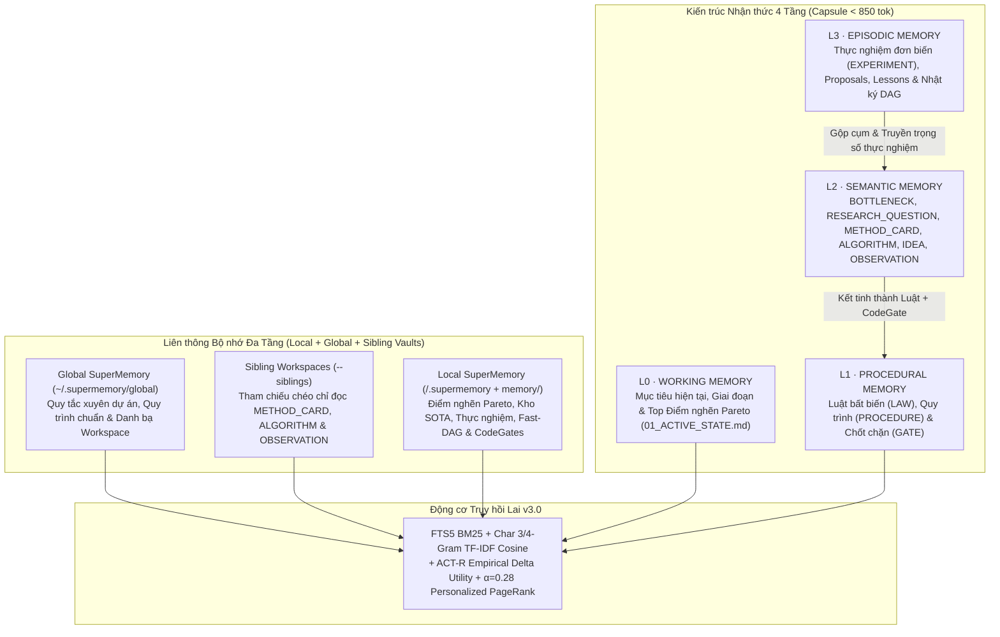
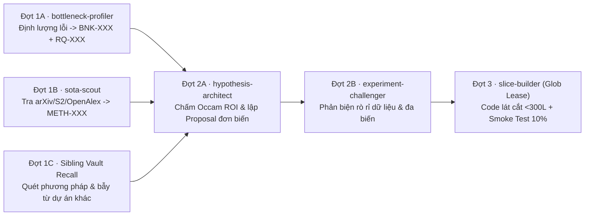

# Research SuperMemory (`v3.0`)

> Language: **[English (Default)](README.md)** | **Tiếng Việt**

**Hệ thống Bộ nhớ Đồ thị Nhận thức 4 Tầng (`Zero-Amnesia 4-Tier Cognitive Graph`), Động cơ Chẩn đoán Điểm nghẽn Pareto (`Bottleneck-First Engine`), Trình Săn Bài báo SOTA Tự động (`arXiv` · `Semantic Scholar` · `OpenAlex` -> `07_METHOD_VAULT`), Truy hồi Lai `Subword TF-IDF + Empirical Utility PageRank`, Bộ Điều phối Đa Agent 3 Đợt (`3-Wave Fast-DAG Orchestrator`), Chốt chặn Hiến pháp `PreToolUse CodeGates`, và Giao diện `Daylight Architectural Studio 3.0` (Song ngữ `EN`/`VI`) — Plugin gốc cho Antigravity CLI kiêm Python SDK `0` thư viện ngoài.**

---

## Mục lục

1. [Bài toán & Bước nhảy vọt ở `v3.0`](#1-bài-toán--bước-nhảy-vọt-ở-v30)
2. [Kiến trúc Nhận thức 4 Tầng, Truy hồi `Hybrid Utility PageRank` & Kho Chéo Dự án](#2-kiến-trúc-nhận-thức-4-tầng-truy-hồi-hybrid-utility-pagerank--kho-chéo-dự-án)
3. [Động cơ Nghiên cứu `Bottleneck-First`, Săn SOTA & Đa Agent `Fast-DAG`](#3-động-cơ-nghiên-cứu-bottleneck-first-săn-sota--đa-agent-fast-dag)
4. [Hình ảnh Giao diện Thực tế (`Daylight Architectural Studio 3.0`)](#4-hình-ảnh-giao-diện-thực-tế-daylight-architectural-studio-30)
5. [Cài đặt 1 Lệnh Duy nhất (`Zero-Clone`)](#5-cài-đặt-1-lệnh-duy-nhất-zero-clone)
6. [Hướng dẫn Quy trình Nghiên cứu Thực tế từ A–Z](#6-hướng-dẫn-quy-trình-nghiên-cứu-thực-tế-từ-az)
7. [Cơ chế Vận hành Hooks Siêu nhẹ (`Zero-Overhead`) & Tự học (`Self-Learning`)](#7-cơ-chế-vận-hành-hooks-siêu-nhẹ-zero-overhead--tự-học-self-learning)
8. [Bảng Tra cứu Đầy đủ Lệnh CLI (`supermemory`)](#8-bảng-tra-cứu-đầy-đủ-lệnh-cli-supermemory)
9. [Bảng Tra cứu 17 MCP Tools, 4 Resources, 9 Skills & 8 Subagents](#9-bảng-tra-cứu-17-mcp-tools-4-resources-9-skills--8-subagents)
10. [Cấu trúc Thư mục Lưu trữ & Quy tắc Git](#10-cấu-trúc-thư-mục-lưu-trữ--quy-tắc-git)
11. [Xử lý Sự cố Thường gặp & Kiểm định Chất lượng](#11-xử-lý-sự-cố-thường-gặp--kiểm-định-chất-lượng)

---

## 1. Bài toán & Bước nhảy vọt ở `v3.0`

Các AI Coding & Research Agents hiện đại (Antigravity, Claude Code, Gemini CLI, Codex, Cursor) thường mắc **5 điểm mù cấu trúc** khi làm nghiên cứu chuyên sâu hoặc chạy dự án dài ngày:

1. **Mất trí nhớ sau khi nén ngữ cảnh (`Context Compaction Amnesia`):** Sau mỗi lần `/compact` hoặc phiên mới, các bất biến kiến trúc và nguyên nhân gốc rễ của lỗi cũ bị rơi rụng.
2. **Đề xuất ý tưởng hầm hố, lan man (`Kitchen-Sink Ungrounded Ideation`):** Chưa mổ xẻ xem phân khúc lỗi nào chiếm tỷ trọng lớn nhất đã vội đề xuất kiến trúc cồng kềnh 500 dòng gộp 3–4 biến cùng lúc.
3. **Mù bài báo mới hoặc nhồi tóm tắt thô gây nhiễu:** Không tự tra cứu các phương pháp SOTA mới nhất, hoặc lưu tràn lan văn bản thô thay vì chắt lọc cơ chế toán học, chi phí tính toán và điểm ghép tối giản.
4. **Lặp lại hướng cụt dưới tên gọi khác & sót từ đồng gốc:** Tìm kiếm từ đơn thuần túy bỏ sót biến thể hình thái học và xếp ngang hàng các thử nghiệm thất bại với các phương pháp đã chứng minh hiệu quả.
5. **Đụng độ file khi chạy đa Agent & đốt tài nguyên vô ích:** Nhiều Agent sửa đè lên cùng một file hoặc chạy hết 100% thời gian huấn luyện dù ngay ở 10% đầu (Smoke Test) hướng đi đã không nhúc nhích.

**Research SuperMemory (`v3.0.0`)** giải quyết trọn vẹn cả 5 vấn đề chỉ bằng **Python 3.10+ chuẩn (`stdlib` 100%, `0` package ngoài, SQLite WAL + FTS5 + Hybrid Utility PageRank)**:

- **Chẩn đoán Điểm nghẽn Pareto & Chốt chặn `Occam's Razor ROI`:** Bắt buộc định lượng phân khúc lỗi (`BNK-XXX`) + Câu hỏi nghiên cứu kiểm chứng được (`RQ-XXX`) trước khi đề xuất, chấm điểm `Occam ROI` và chặn cứng các ý tưởng đa biến lan man hoặc bình mới rượu cũ lặp lại hướng chết.
- **Tự động Săn Bài báo SOTA & Kho `07_METHOD_VAULT`:** Truy vấn trực tiếp **arXiv + Semantic Scholar + OpenAlex** có bộ nhớ đệm SQLite (`http_cache`), tự động đúc kết thành thẻ phương pháp 5 trường chuẩn (`METH-XXX`) gắn thẳng vào điểm nghẽn mục tiêu (`CANDIDATE_FOR -> BNK-XXX`).
- **Truy hồi Lai `Subword 3/4-Gram TF-IDF + Empirical Utility PageRank` & Kho Chéo Dự án (`--siblings`):** Bắt chính xác biến thể từ vựng, ưu tiên tri thức từng giúp tăng điểm thực nghiệm (`ACT-R utility`) và tham chiếu chéo kho phương pháp từ các dự án anh em trên cùng máy.
- **Điều phối Đa Agent `3-Wave Fast-DAG` & Khóa Vùng File (`Glob Lease`):** Phối hợp **8 Subagents chuyên biệt** chạy song song không đụng độ file (`BEGIN IMMEDIATE` SQLite lease), kèm cơ chế dừng sớm 10% (`EARLY_KILLED` cascade) giúp tiết kiệm tối đa thời gian và chi phí.

---

## 2. Kiến trúc Nhận thức 4 Tầng, Truy hồi `Hybrid Utility PageRank` & Kho Chéo Dự án

Lấy cảm hứng từ **CoALA / ACT-R**, SuperMemory tổ chức bộ nhớ thành **4 tầng nhận thức** kết hợp **Liên thông 3 nguồn (`Local` + `Global` `~/.supermemory/global` + `Sibling` dự án anh em chỉ đọc)**, giữ Capsule nạp đầu phiên luôn gọn dưới **`850 tokens`**:



---

## 3. Động cơ Nghiên cứu `Bottleneck-First`, Săn SOTA & Đa Agent `Fast-DAG`



1. **Chẩn đoán Điểm nghẽn Pareto (`BNK-XXX` + `RQ-XXX`):** Xếp hạng lỗi theo `Pareto Priority = Tỷ trọng lỗi (%) × Biên độ cải thiện tối đa`, buộc Agent tập trung giải quyết 80% nguyên nhân gây tụt điểm trước tiên.
2. **Chốt chặn Chống Lan man `Occam's Razor ROI`:** Chấm điểm mọi ý tưởng/đề xuất qua công thức:
   $$\text{Occam ROI} = \frac{\text{ErrorShare} \times \max(\text{CeilingGain}, 0.05)}{0.5 + 0.5\,\text{CoupledVars}^2 + \text{EstLOC}/120}$$
   Khi bật `strict_occam=True`, mọi đề xuất không gắn vào `BNK-XXX`, trộn lẫn nhiều biến độc lập hoặc thiếu tiêu chí dừng sớm `kill_criterion` đều bị từ chối tự động.
3. **Kho Phương pháp SOTA Có Bộ nhớ đệm (`07_METHOD_VAULT`):** Tìm bài báo mới nhất trên arXiv, Semantic Scholar và OpenAlex (lưu đệm trong bảng `http_cache` của SQLite theo `LAW-04`) và đóng gói thành thẻ `METH-XXX` 5 mục cô đọng.
4. **Khóa Vùng File (`Glob Lease`) & Dừng sớm 10% (`EARLY_KILLED`):** Các tác vụ trong `agent_tasks` được nhận nguyên tử qua `BEGIN IMMEDIATE`, chặn xung đột vùng file `locked_globs` khi nhiều `slice-builder` chạy song song, và tự động hủy chuỗi tác vụ phía sau nếu Smoke Test 10% không đạt ngưỡng.

---

## 4. Hình ảnh Giao diện Thực tế (`Daylight Architectural Studio 3.0`)

Giao diện quản trị cục bộ không cần Internet/CDN (`http://127.0.0.1:8765`), mặc định **Tiếng Anh (`EN`)** kèm nút **1-click `VI` / `EN`**, bổ sung Trung tâm **`Research & DAG`**, **Bộ hiển thị Công thức Toán học LaTeX & Markdown Khoa học**, **Khung Đọc Chi tiết 3 Chế độ (`Giữa màn / Center Modal` · `Chia đôi / Split-Pane` · `Nổi / Floating` — phím `F`)**, và đảm bảo `0px` tràn viền trên cả Desktop (`1440x920`) lẫn Mobile (`375x812`):

### Trung tâm Nghiên cứu `Bottleneck-First`, Kho Phương pháp SOTA & Bảng Điều phối `3-Wave Fast-DAG`


### Khung Phóng to Giữa Màn (`Center Modal` — Phím `F`) Hiển thị Toán học LaTeX Sắc nét


### Bản đồ Tri thức Có hướng 4 Chế độ (`Force` · `Radial` · `Hierarchy` · `Lanes`) & Split-Pane Studio


### Quản lý Vòng đời Proposals Phân trang & Sổ cái Thực nghiệm Đơn biến


---

## 5. Cài đặt 1 Lệnh Duy nhất (`Zero-Clone`)

```bash
curl -fsSL https://raw.githubusercontent.com/vtnguyen04/research-supermemory/main/install.sh | bash
```

Lệnh trên tự động cài đặt CLI `supermemory` (kèm alias `research-supermemory`) vào `~/.local/bin/` và chạy `supermemory install-plugin` để kiểm định (`agy plugin validate --strict`) rồi kích hoạt trọn bộ **9 Skills · 8 Subagents · 1 Rule · 1 Lifecycle Hook · 1 MCP Server (`17` công cụ)** vào Antigravity CLI.

```bash
# Hoặc cài trực tiếp qua uv:
uv tool install git+https://github.com/vtnguyen04/research-supermemory.git && ~/.local/bin/supermemory install-plugin

# Hoặc cài ở chế độ phát triển (Editable):
git clone https://github.com/vtnguyen04/research-supermemory.git
cd research-supermemory
uv tool install --editable . --force && supermemory install-plugin
```

---

## 6. Hướng dẫn Quy trình Nghiên cứu Thực tế từ A–Z

### 6.1. Khởi tạo dự án mới

```bash
cd /duong-dan/toi/du-an
supermemory init . \
  --name "WorldModel-Research" \
  --max-lines 300 \
  --goal "Achieve reproducible SOTA on latent state prediction with zero test-set leakage"
```

### 6.2. Chu trình Chuẩn `v3.0`: Chẩn đoán Điểm nghẽn -> Săn SOTA -> Điều phối `3-Wave Fast-DAG`

```bash
# 1. Định lượng điểm nghẽn Pareto & đặt Câu hỏi Nghiên cứu kiểm chứng được (RQ) trước khi nghĩ giải pháp:
supermemory bottleneck diagnose \
  --title "Long-horizon rollout drift beyond 16 latent steps" \
  --error-share 58.0 \
  --ceiling-gain 0.09 \
  --metric "val_f1" \
  --evidence-slice "Chuỗi >16 bước chiếm 58% tổng sai số trên tập validation" \
  --rq "Liệu cơ chế stop-grad consistency có giảm >=25% sai số ở bước >16 với chi phí tính toán <5%?" \
  --kill-criterion "Dừng ngay ở 10% smoke slice nếu MSE bước 16 cải thiện < 3%" \
  --smoke-cmd "pytest -q tests/test_rollout_smoke.py"

# 2. Tự động săn bài báo SOTA từ arXiv + Semantic Scholar + OpenAlex và đúc thành thẻ METH-XXX:
supermemory scout search "latent rollout consistency model predictive control" \
  --bottleneck BNK-001 \
  --min-year 2024 \
  --save-top 2

# 3. Truy hồi lai kết hợp Local + Global + các dự án anh em (--siblings):
supermemory recall "stop-grad latent rollout drift" --siblings

# 4. Lập kế hoạch Sprint 3-Wave Đa Agent và nhận tác vụ thực thi có khóa file:
supermemory orchestrate plan \
  --goal "Giải quyết điểm nghẽn BNK-001 với điểm Occam ROI cao nhất" \
  --bottleneck BNK-001 \
  --globs "src/models/**" \
  --smoke-cmd "pytest -q tests/test_rollout_smoke.py"

supermemory orchestrate claim --agent slice-builder
```

### 6.3. Mở Giao diện `Daylight Architectural Studio 3.0` (`EN` / `VI`)

```bash
supermemory ui --port 8765      # Mở Studio cho dự án hiện tại
supermemory ui --global         # Hoặc mở Global SuperMemory từ bất kỳ đâu
```

---

## 7. Cơ chế Vận hành Hooks Siêu nhẹ (`Zero-Overhead`) & Tự học (`Self-Learning`)

| Sự kiện Hook | Độ trễ | Hành vi chính xác trong `v3.0` |
| :--- | :--- | :--- |
| **`SessionStart`** | `< 30ms` | Nạp Capsule 4 tầng (`L0 + L1` + Top Điểm nghẽn `BOTTLENECK` đang mở `< 850` tokens) và khôi phục `HANDOFF_BRIEFING.md` sau `/compact`. |
| **`PreInvocation`** | `< 15ms` | **Im lặng 100% (`{}`)** trên các câu hỏi đáp thông thường; chỉ tiêm cảnh báo khi có quy tắc mới, khớp cảnh báo lặp lỗi `Anti-Repeat` hoặc nhịp `/goal`. |
| **`PreToolUse`** | `< 20ms` | Chặn cứng mọi thao tác vi phạm qua **6 loại chốt chặn**: `MAX_LINES`, `FORBIDDEN_FILENAME`, `AST_SYNTAX`, `FORBIDDEN_CMD_PATTERN`, `FORBIDDEN_REGEX`, `FROZEN_SHA256`. |
| **`PostToolUse`** | `< 15ms` | Theo dõi lệnh chạy benchmark thực nghiệm và tự mở khóa ngay khi đã gọi `record_lesson` hoặc `log_experiment`. |
| **`Stop`** | `< 10ms` | Kết thúc lượt trả lời ngay lập tức (`0` lượt phụ) với hội thoại thường; chỉ giữ lại nếu bài học quy tắc hoặc kết quả benchmark chưa được ghi sổ. |

---

## 8. Bảng Tra cứu Đầy đủ Lệnh CLI (`supermemory`)

| Lệnh CLI | Lệnh con / Cờ chính | Chức năng chi tiết |
| :--- | :--- | :--- |
| `supermemory init [dir]` | `--name`, `--max-lines`, `--goal` | Khởi tạo Local SuperMemory, 8 Luật Hiến pháp, 4 CodeGates mặc định và bộ file quy tắc Agent. |
| `supermemory status` | `-w <dir>`, `-g` | Hiển thị Capsule 4 tầng, điểm nghẽn Pareto đang mở và mức tiêu thụ token. |
| `supermemory workspaces` | *(không)* | Liệt kê Global SuperMemory và toàn bộ dự án Local đã đăng ký trên máy. |
| `supermemory recall "<query>"` | `--siblings`, `--limit`, `--hops`, `-w`, `-g` | Truy hồi liên thông bằng Hybrid BM25 + Subword TF-IDF + Empirical Utility PageRank. |
| `supermemory bottleneck` | `diagnose`, `list`, `resolve <BNK_ID>` | Định lượng điểm nghẽn Pareto (`BNK-XXX`), tạo câu hỏi `RQ-XXX` và đóng điểm nghẽn đã xử lý. |
| `supermemory scout` | `search "<query>"`, `card` | Săn bài báo SOTA từ **arXiv + Semantic Scholar + OpenAlex** (có cache SQLite) và lưu thẻ `METH-XXX`. |
| `supermemory orchestrate` | `plan`, `status`, `claim`, `complete` | Lập lịch Đa Agent `3-Wave Fast-DAG`, nhận việc nguyên tử kèm khóa `locked_globs` và dừng sớm 10%. |
| `supermemory learn` | `--title`, `--mistake`, `--root-cause`, `--rule`, `--forbid-regex`, `-g` | Kết tinh lỗi sai hoặc quy tắc người dùng thành `LESSON` + `LAW` + `CodeGate`. |
| `supermemory consolidate` | `--ids A,B` hoặc `--auto`, `--tier`, `-g` | Gộp các mảnh lịch sử `L3` thành tri thức `L2` hoặc quy trình `L1`. |
| `supermemory promote <ID>` | `-w <dir>` | Đưa Luật, Thẻ Phương pháp SOTA, Thuật toán hoặc Quy trình từ Local lên Global SuperMemory. |
| `supermemory gate` | `list`, `add`, `freeze <file>` | Quản lý chốt chặn `PreToolUse` và khóa băm `SHA-256` cho file chấm điểm. |
| `supermemory idea` | `--title`, `--summary`, `--bottleneck`, `--strict-occam` | Lưu `IDEA` / `ALGORITHM` (tự chấm `Occam ROI`) hoặc đánh dấu hướng cụt `REJECTED`. |
| `supermemory proposal` | `create`, `advance <ID> <STAGE>` | Quản lý vòng đời OpenSpec Proposal kèm kiểm tra `Occam ROI` và chống lặp cơ chế. |
| `supermemory exp` | `--track`, `--title`, `--hypothesis`, `--diff`, `--verdict` | Ghi nhận thực nghiệm đơn biến, tự tính độ lệch Baseline và trích xuất `OBSERVATION` tầng `L2`. |
| `supermemory audit` | `-w <dir>` | Quét toàn bộ mã nguồn dự án đối chiếu với tất cả `CodeGate` đang bật. |
| `supermemory sync` / `handoff` | `-w <dir>` | Đồng bộ SQLite ra Markdown / `graph_snapshot.json` hoặc xuất `HANDOFF_BRIEFING.md`. |
| `supermemory ui` | `-w <dir>`, `-g`, `--host`, `--port` | Khởi chạy máy chủ giao diện **Daylight Architectural Studio `3.0`**. |
| `supermemory install-plugin` | `--validate-only` | Kiểm định (`--strict`) và cài đặt/cập nhật Plugin vào Antigravity CLI. |

---

## 9. Bảng Tra cứu 17 MCP Tools, 4 Resources, 9 Skills & 8 Subagents

### 9.1. 17 Công cụ MCP Gốc (`mcp_config.json`)
1. `init` — Khởi tạo không gian bộ nhớ Local mới.
2. `status` — Đọc Capsule 4 tầng, danh sách điểm nghẽn mở và thống kê token.
3. `recall` — Truy hồi lai Subword TF-IDF + Empirical Utility PageRank (`include_siblings` hỗ trợ quét dự án anh em).
4. `diagnose_bottleneck` — Chẩn đoán/xếp hạng/đóng điểm nghẽn Pareto `BNK-XXX`, `RQ-XXX` và chấm điểm `Occam ROI`.
5. `scout_sota` — Tìm bài báo trên arXiv, Semantic Scholar & OpenAlex (lưu đệm SQLite) và đúc thẻ `METH-XXX` vào `07_METHOD_VAULT`.
6. `orchestrate` — Lập lịch `3-Wave Fast-DAG`, nhận việc nguyên tử có khóa file `locked_globs`, và kích hoạt dừng sớm 10% `EARLY_KILLED`.
7. `record_lesson` — Tự lưu quy tắc người dùng hoặc bài học hậu kiểm kèm `CodeGate`.
8. `add_gate` — Bổ sung chốt chặn `PreToolUse` hoặc khóa `SHA-256`.
9. `propose_idea` — Lưu `IDEA` / `ALGORITHM` (chấm `Occam ROI`) hoặc đánh dấu hướng cụt `REJECTED`.
10. `manage_proposal` — Tạo và chuyển giai đoạn OpenSpec Proposal kèm cổng kiểm tra Occam & chống lặp.
11. `log_experiment` — Ghi sổ thực nghiệm đơn biến và tự trích xuất `OBSERVATION`.
12. `update_state` — Cập nhật mục tiêu, giai đoạn và bước tiếp theo ở tầng `L0`.
13. `link_knowledge` — Tạo nút tri thức tùy chỉnh và nối cạnh có hướng trên đồ thị.
14. `consolidate` — Nén/gộp các nút `L3` thành tri thức `L2` hoặc quy trình `L1`.
15. `checkpoint` — Xác nhận trạng thái bộ nhớ cuối lượt.
16. `audit_gates` — Kiểm định toàn bộ CodeGates trên workspace.
17. `record_audit` — Ghi chữ ký phê duyệt/phản biện của `Challenger` hoặc `VictoryAuditor`.

### 9.2. 9 Kỹ năng Slash Skills & 8 Subagents Chuyên biệt
- **9 Skills:** `supermemory-init`, `supermemory-research`, `supermemory-orchestrate`, `supermemory-learn`, `supermemory-propose`, `supermemory-experiment`, `supermemory-audit`, `supermemory-handoff`, `supermemory-ui`.
- **8 Subagents:**
  - `bottleneck-profiler`: Mổ xẻ sai số theo phân khúc dữ liệu, đăng ký điểm nghẽn Pareto `BNK-XXX` và câu hỏi kiểm chứng `RQ-XXX` trước khi lên ý tưởng.
  - `sota-scout`: Săn bài báo SOTA từ arXiv / Semantic Scholar / OpenAlex và lưu thẻ phương pháp 5 mục vào `07_METHOD_VAULT/METH-XXX.md`.
  - `hypothesis-architect`: Kết hợp `BNK-XXX` + `METH-XXX` để thiết kế đề xuất đơn biến có điểm `Occam ROI` cao nhất kèm ngưỡng dừng sớm 10%.
  - `slice-builder`: Nhận lát cắt code dưới khóa `locked_globs` (`< 300` dòng/file), chạy Smoke Gate 10% trước tiên (`EARLY_KILLED` nếu không cải thiện) rồi ghi sổ thực nghiệm.
  - `experiment-challenger`: Phản biện đối kháng săn lỗi rò rỉ dữ liệu, nhập nhằng đa biến và lặp lại cơ chế cũ.
  - `victory-auditor`: Kiểm toán viên độc lập xác minh điểm số, khóa `FROZEN_SHA256` và bộ test trước khi đóng Proposal.
  - `root-cause-investigator`: Điều tra nguyên nhân gốc rễ 5-Whys và thiết kế `PreToolUse CodeGate` chặn tái phát.
  - `memory-curator`: Kiểm toán vệ sinh đồ thị bộ nhớ, giữ `01_ACTIVE_STATE.md` (`< 150`L) và `02_CONSTITUTION_AND_LESSONS.md` (`< 200`L) gọn sạch.

---

## 10. Cấu trúc Thư mục Lưu trữ & Quy tắc Git

```text
<thu-muc-du-an>/
├── .supermemory/
│   ├── supermemory.db          # [Git Ignored] SQLite WAL + FTS5 + HTTP Cache + Bảng DAG (tự tái tạo)
│   └── runtime/                # [Git Ignored] Trạng thái phiên tạm thời của Hook
├── memory/                     # [Git Tracked cho Repo Nội bộ] Nguồn chân lý chung cho nhóm & đa Agent
│   ├── graph_snapshot.json     # Ảnh chụp toàn vẹn Đồ thị + Gates + Thực nghiệm + DAG để khôi phục 100%
│   ├── 00_MEMORY_GRAPH.md      # Tổng quan đồ thị, Điểm nghẽn Pareto & Kho Phương pháp SOTA
│   ├── 01_ACTIVE_STATE.md      # Tầng L0 Working Memory + Top Điểm nghẽn mở (< 150 dòng)
│   ├── 02_CONSTITUTION_AND_LESSONS.md # Tầng L1 Hiến pháp & CodeGates (< 200 dòng)
│   ├── 03_EXPERIMENTS_REGISTRY.md     # Bảng xếp hạng thực nghiệm đơn biến
│   ├── HANDOFF_BRIEFING.md     # Bản bàn giao chống mất ngữ cảnh
│   ├── lessons/                # Chi tiết bài học hậu kiểm (LESSON-*.md)
│   ├── experiments/            # Nhật ký thực nghiệm theo nhánh (EXP-*.md)
│   ├── 04_PROPOSALS/           # Đặc tả OpenSpec (proposal.md, design.md, tasks.md)
│   ├── 05_IDEAS_AND_ALGORITHMS/# Ý tưởng, thuật toán & hướng bị loại bỏ
│   ├── 06_KNOWLEDGE_NODES/     # Điểm nghẽn (BNK-*), Câu hỏi (RQ-*) & Nhận xét (OBS-*)
│   └── 07_METHOD_VAULT/        # Thẻ Phương pháp SOTA chuẩn hóa (METH-*.md)
├── .agents/
│   ├── rules/00_supermemory_constitution.md
│   └── hooks.json
└── AGENTS.md / GEMINI.md / CLAUDE.md
```

> **Lưu ý Repo Nội bộ vs. Repo Công khai (`Public Open-Source`):** Với repo nhóm nội bộ (`private`), hãy commit `memory/` để đồng bộ tri thức giữa các thành viên. Khi đẩy **mã nguồn công khai (`public`)** lên GitHub, hãy giữ `.supermemory/`, `memory/`, `.agents/`, `/AGENTS.md`, `/CLAUDE.md`, `/GEMINI.md` trong `.gitignore` để bộ nhớ cá nhân chỉ nằm riêng trên máy của bạn.

---

## 11. Xử lý Sự cố Thường gặp & Kiểm định Chất lượng

```bash
# Khởi động lại Studio 3.0 nếu cổng 8765 đang bận:
fuser -k 8765/tcp 2>/dev/null; supermemory ui --port 8765

# Chạy trọn bộ kiểm thử & tự kiểm định Hiến pháp:
pytest -v
ruff check src tests
mypy src
supermemory install-plugin --validate-only
supermemory audit
```

---

## Giấy phép (`License`)

Phát hành theo giấy phép **MIT License**.
