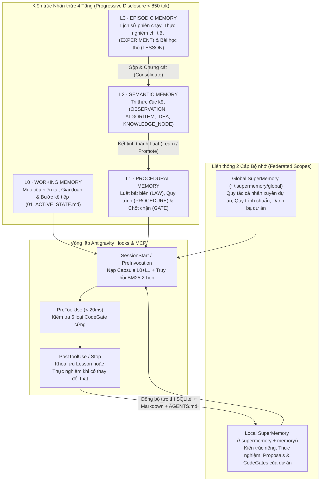
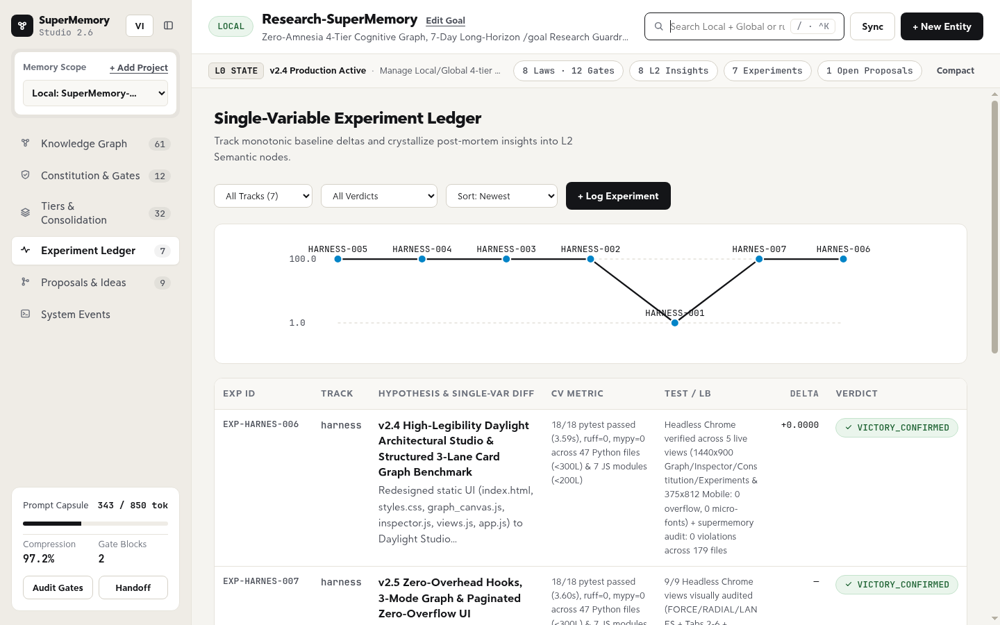

# Research SuperMemory (`v2.6`)

> Language: **[English (Default)](README.md)** | **Tiếng Việt**

**Hệ thống Bộ nhớ Đồ thị Nhận thức 4 Tầng (Zero-Amnesia 4-Tier Cognitive Graph), Chốt chặn Hiến pháp Thời gian thực (`PreToolUse CodeGates`), Cơ chế Tự học Bài học & Khóa Lỗi Lặp lại, Sổ cái Thực nghiệm Khoa học Đơn biến, Quản lý Vòng đời OpenSpec, và Giao diện Quản trị Daylight Architectural Studio (Song ngữ `EN`/`VI`) — Tích hợp sâu làm Plugin gốc cho Antigravity CLI kiêm CLI/SDK độc lập không phụ thuộc thư viện ngoài.**

---

## Mục lục

1. [Bài toán & Lý do ra đời](#1-bài-toán--lý-do-ra-đời)
2. [Kiến trúc Nhận thức 4 Tầng & Liên thông Local + Global](#2-kiến-trúc-nhận-thức-4-tầng--liên-thông-local--global)
3. [Hình ảnh Giao diện Thực tế (`Daylight Architectural Studio`)](#3-hình-ảnh-giao-diện-thực-tế-daylight-architectural-studio)
4. [Cài đặt 1 Lệnh Duy nhất (`Zero-Clone`)](#4-cài-đặt-1-lệnh-duy-nhất-zero-clone)
5. [Hướng dẫn Sử dụng Thực tế từ A–Z](#5-hướng-dẫn-sử-dụng-thực-tế-từ-az)
6. [Cơ chế Vận hành Hooks Siêu nhẹ (`Zero-Overhead`) & Tự học (`Self-Learning`)](#6-cơ-chế-vận-hành-hooks-siêu-nhẹ-zero-overhead--tự-học-self-learning)
7. [Bảng Tra cứu Đầy đủ Lệnh CLI (`supermemory`)](#7-bảng-tra-cứu-đầy-đủ-lệnh-cli-supermemory)
8. [Bảng Tra cứu 14 MCP Tools, 4 Resources, 7 Skills & 4 Subagents](#8-bảng-tra-cứu-14-mcp-tools-4-resources-7-skills--4-subagents)
9. [Cấu trúc Thư mục Lưu trữ & Quy tắc Git](#9-cấu-trúc-thư-mục-lưu-trữ--quy-tắc-git)
10. [Xử lý Sự cố Thường gặp & Kiểm định Chất lượng](#10-xử-lý-sự-cố-thường-gặp--kiểm-định-chất-lượng)

---

## 1. Bài toán & Lý do ra đời

Các AI Coding & Research Agents hiện đại (Antigravity, Claude Code, Gemini CLI, Codex, Cursor) đều gặp **3 điểm mù cấu trúc** khi chạy dự án lớn hoặc nghiên cứu dài ngày:

1. **Mất trí nhớ sau khi nén ngữ cảnh (`Context Compaction Amnesia`):** Mỗi khi chạy `/compact` hoặc mở phiên mới, các quy ước kiến trúc, yêu cầu riêng của bạn, và nguyên nhân sâu xa của các lỗi từng gặp bị rơi rụng.
2. **Lặp lại hướng thử nghiệm đã thất bại (`Dead-End Repetition`):** Khi giao bài toán nghiên cứu dài hơi (ví dụ chạy `/goal` nhiều ngày), Agent dễ thử lại đúng ý tưởng/siêu tham số đã thất bại hôm trước, hoặc sửa nhiều biến cùng lúc làm nhiễu kết luận.
3. **File `.md` phình to gây ngộp ngữ cảnh hoặc bị Agent phớt lờ:** Ghi chép thuần văn bản không có cơ chế phân tầng token và không thể chặn cứng hành vi sai trước khi lệnh sửa file được thực thi.

**Research SuperMemory (`v2.5`)** giải quyết triệt để cả 3 vấn đề chỉ bằng **Python 3.10+ chuẩn (`stdlib` 100%, `0` thư viện ngoài, SQLite WAL + FTS5 BM25)**:

- **Lưu trữ kép bất biến (`Dual-Persistence`):** Mọi thực thể sống đồng thời trong cơ sở dữ liệu đồ thị **SQLite FTS5** (`.supermemory/supermemory.db` — truy vấn `< 5ms`) và **JSON/Markdown đồng bộ Git** (`memory/graph_snapshot.json`, `00_MEMORY_GRAPH.md`, `01_ACTIVE_STATE.md`, `02_CONSTITUTION_AND_LESSONS.md`, `03_EXPERIMENTS_REGISTRY.md`). Khi sang máy mới `git clone`, toàn bộ đồ thị tự động khôi phục 100% từ `graph_snapshot.json`.
- **Chặn lỗi bằng thực thi cơ học (`PreToolUse CodeGates < 20ms`):** Mọi bài học không nằm chết trên giấy mà gắn thẳng với chốt chặn `PreToolUse` để từ chối tức thì (`"decision": "deny"`) các thao tác vi phạm trước khi file bị ghi xuống đĩa.
- **Vận hành `Zero-Overhead` không làm chậm hội thoại:** Trên các câu hỏi đáp, giải thích code hoặc trao đổi ngắn thông thường, Hook tiêu tốn **0 lượt gọi LLM phụ**; chỉ kích hoạt khóa kiểm tra khi có chỉ thị quy tắc mới, sửa lỗi thực sự hoặc chạy benchmark thực nghiệm.

---

## 2. Kiến trúc Nhận thức 4 Tầng & Liên thông Local + Global

Lấy cảm hứng từ kiến trúc nhận thức **CoALA / ACT-R**, SuperMemory chia tri thức thành **4 tầng bộ nhớ** kết hợp cơ chế **Liên thông 2 cấp (`Local` theo từng dự án + `Global` toàn máy tại `~/.supermemory/global`)** giúp Capsule nạp đầu phiên luôn gọn dưới **`850 tokens`** (tiết kiệm >95% ngữ cảnh):



| Tầng nhận thức | Thực thể đại diện | Cơ chế nạp vào Agent |
| :--- | :--- | :--- |
| **`L0 · WORKING`** | `01_ACTIVE_STATE.md` (`< 150` dòng) | Luôn nạp đầu phiên để giữ mục tiêu chiến lược và tiến độ hiện tại. |
| **`L1 · PROCEDURAL`** | `LAW`, `PROCEDURE`, `GATE` (`< 200` dòng) | Luôn nạp tóm tắt vào Capsule và đồng bộ thẳng ra `AGENTS.md` / `GEMINI.md` / `CLAUDE.md`. |
| **`L2 · SEMANTIC`** | `OBSERVATION`, `ALGORITHM`, `IDEA`, `KNOWLEDGE_NODE` | Không nhồi toàn bộ vào đầu phiên; tự động truy hồi theo ngữ cảnh qua **FTS5 BM25 + lan truyền đồ thị 2-hop**. |
| **`L3 · EPISODIC`** | `EXPERIMENT`, `PROPOSAL`, `LESSON`, `AGENT_RUN` | Lưu phân trang trên đĩa; cảnh báo tức thì nếu trùng hướng đã thất bại (`Anti-Repeat`) và hỗ trợ gộp cụm lên `L2`/`L1`. |

---

## 3. Hình ảnh Giao diện Thực tế (`Daylight Architectural Studio v2.6.1`)

Giao diện Web quản trị chạy cục bộ không cần Internet/CDN (`http://127.0.0.1:8765`), thiết kế theo phong cách **Daylight Utilitarian Minimalism**, mặc định **Tiếng Anh (`EN`)** kèm nút **1-click `VI` / `EN`**, tích hợp **Bộ biên dịch Công thức Toán học LaTeX & Markdown Khoa học (`$...$`, `$$...$$`, `\mathcal`, `\mathbb`, `\frac`, `\sqrt`, chỉ số trên/dưới kép)**, **Bảng chi tiết 3 Chế độ (`Giữa màn / Center Modal` · `Chia đôi / Split-Pane` · `Nổi / Floating` — phím tắt `F` hoặc nhấp đúp tiêu đề)**, mở rộng tối đa chiều ngang (`Wide`), nút lùi lịch sử (`←`), **`/` & `Ctrl+K` Command Popover**, thu gọn thanh bên trái, dải trạng thái L0 trực tiếp, và xem/sửa đầy đủ biểu thức Regex của từng `CodeGate`:

### Bản đồ Tri thức Có hướng 4 Chế độ (`Force` · `Radial` · `Hierarchy` · `Lanes`) & Split-Pane Studio


### Quản lý Vòng đời Proposals Phân trang & Sổ cái Thực nghiệm Đơn biến




---

## 4. Cài đặt 1 Lệnh Duy nhất (`Zero-Clone`)

### Yêu cầu hệ thống
- Hệ điều hành: **Linux**, **macOS** hoặc **WSL2**.
- **Python `>= 3.10`** (không cần cài bất kỳ package phụ thuộc bên thứ ba nào).
- *(Tùy chọn)* `uv` hoặc `pipx` và `agy` (Antigravity CLI) — trình cài đặt sẽ tự động nhận diện tất cả.

### Cài đặt mới hoặc Cập nhật lên bản mới nhất (1 dòng duy nhất, đứng ở bất kỳ đâu)

```bash
curl -fsSL https://raw.githubusercontent.com/vtnguyen04/research-supermemory/main/install.sh | bash
```

Lệnh duy nhất trên tự động thực hiện trọn gói:
1. Tải và cài đặt CLI `supermemory` (cùng alias `research-supermemory`) vào `~/.local/bin/` (ưu tiên `uv tool` -> `pipx` -> hoặc tự tạo môi trường cô lập `~/.local/share/supermemory-venv` nếu máy chỉ có `python3` thuần).
2. Tự chạy `supermemory install-plugin` để kiểm định nghiêm ngặt (`agy plugin validate --strict`) và kích hoạt bộ **7 Skills · 4 Subagents · 1 Rule · 1 Lifecycle Hook · 1 MCP Server** vào Antigravity CLI.

> **Lưu ý biến môi trường `PATH`:** Nếu lần đầu máy bạn chưa thêm `~/.local/bin` vào `PATH`, hãy thêm dòng sau vào `~/.bashrc` hoặc `~/.zshrc`:
> ```bash
> export PATH="$HOME/.local/bin:$PATH"
> ```

### Các cách cài đặt thay thế

```bash
# Cài trực tiếp 1 dòng qua uv:
uv tool install git+https://github.com/vtnguyen04/research-supermemory.git && ~/.local/bin/supermemory install-plugin

# Hoặc cài ở chế độ phát triển (Editable mode) khi muốn chỉnh sửa mã nguồn:
git clone https://github.com/vtnguyen04/research-supermemory.git
cd research-supermemory
uv tool install --editable . --force && supermemory install-plugin
```

### Gỡ cài đặt (nếu cần)

```bash
agy plugin uninstall supermemory
uv tool uninstall research-supermemory   # hoặc: rm -rf ~/.local/share/supermemory-venv ~/.local/bin/supermemory ~/.local/bin/research-supermemory
```

---

## 5. Hướng dẫn Sử dụng Thực tế từ A–Z

### 5.1. Khởi tạo cho dự án mới (hoặc dự án có sẵn chưa có SuperMemory)

Bạn có thể làm việc theo 2 cách hoàn toàn linh hoạt:
- **Chưa chạy `init`:** Agent vẫn hoạt động bình thường dựa trên **Global SuperMemory** (`~/.supermemory/global`) mà không tạo bất kỳ file nào làm bẩn repo hiện tại.
- **Khởi tạo Local SuperMemory riêng cho dự án:**

```bash
cd /duong-dan/toi/du-an
supermemory init . \
  --name "WorldModel-Research" \
  --max-lines 300 \
  --goal "Achieve reproducible SOTA on latent state prediction with zero test-set leakage"
```

Lệnh `init` sẽ khởi tạo `.supermemory/supermemory.db`, thư mục `memory/`, 8 Luật Hiến pháp gốc (`LAW-01`..`LAW-08`), 4 chốt chặn mặc định (`GATE-001`..`GATE-004`), đồng thời sinh file quy tắc gọn nhẹ cho mọi Agent (`AGENTS.md`, `GEMINI.md`, `CLAUDE.md`, `.agents/`).

### 5.2. Mở Giao diện Web Studio (Local & Global, Song ngữ `EN`/`VI`)

```bash
# Đứng trong thư mục dự án để mở Local Studio của dự án đó:
supermemory ui --port 8765

# Hoặc đứng ở BẤT KỲ ĐÂU trên máy để mở thẳng Global SuperMemory:
supermemory ui --global
# (viết tắt: supermemory ui -g)
```

Sau khi mở `http://127.0.0.1:8765`:
- **Chuyển đổi ngôn ngữ `EN` / `VI`:** Giao diện mặc định là Tiếng Anh (`EN`); nhấn nút **`VI`** ngay cạnh tên `SuperMemory v2.5` ở góc trên bên trái để chuyển toàn bộ sang Tiếng Việt (tự động nhớ lựa chọn cho các lần mở sau, hoặc truyền `?lang=vi` / `?lang=en`).
- **Chuyển đổi dự án tức thì:** Dùng hộp chọn **Memory Workspace** ở góc trên bên trái để chuyển qua lại giữa `Global: All Workspaces` và mọi dự án `Local` mà không cần khởi động lại server.
- **3 Chế độ Bản đồ Tri thức:** Chuyển đổi mượt giữa **`Force`** (`FORCE` mặc định), **`Radial`** (`RADIAL` 3 vòng tầng `L1`/`L2`/`L3`), và **`Lanes`** (`LANES` 3 cột thẻ kiến trúc); bấm vào bất kỳ nút nào để mở ngăn kéo chi tiết bên phải (**Slide-Over Inspector**) sửa/xóa/nối cạnh hoặc **Promote to Global**.
- **Gộp & Nén Tri thức (`Tiers & Consolidate`):** Tick chọn các bài học/thực nghiệm rời rạc ở tầng `L3` để chưng cất thành nguyên lý `L2 Semantic` hoặc luật `L1 Procedural`.
- **Phím tắt tiện lợi:** Nhấn `/` để nhảy nhanh vào ô tìm kiếm liên thông BM25, `Esc` để đóng ngăn chi tiết, `+` / `-` / `0` trên bản đồ để phóng to, thu nhỏ, vừa khung.

### 5.3. Ra lệnh trực tiếp bằng ngôn ngữ tự nhiên cho Agent tự lưu Rule / Bài học

Bạn không bắt buộc phải mở UI hay gõ CLI thủ công. Ngay trong khung chat Antigravity (bằng Tiếng Anh hoặc Tiếng Việt), bạn có thể ra lệnh tự nhiên:
- *"Save rule to global: always use Google-style docstrings and never use the walrus operator in Python."* -> Agent tự gọi `supermemory_record_lesson(scope="global")` và cập nhật Global Law.
- *"Mỗi lần sửa UI xong phải tự chụp ảnh màn hình kiểm tra hết các tab xem có tràn viền không, lưu vào lesson và khóa gate lại."* -> Agent tự kết tinh thành `LESSON` + `LAW` + `CodeGate` kiểm tra tự động ở `PreToolUse`.

Hoặc ghi bằng CLI bất kỳ lúc nào:

```bash
# Lưu bài học + khóa Regex chặn cứng vào dự án hiện tại:
supermemory learn \
  --title "Ban fixed 5+ column CSS grids causing viewport clipping" \
  --mistake "Used repeat(6, minmax(14.5rem, 1fr)) which clipped rightmost column on 1440px" \
  --root-cause "Total min-width exceeded center viewport" \
  --rule "Always use auto-fill with paginated lists" \
  --law LAW-03 \
  --forbid-regex "repeat\(\s*[5-9]\s*,\s*minmax\(" \
  --target-glob "src/**/*.css"

# Thêm cờ -g (--global) nếu muốn lưu thành quy tắc áp dụng cho MỌI dự án trên máy:
supermemory learn -g --title "..." --mistake "..." --root-cause "..." --rule "..."
```

### 5.4. Khóa bất biến tập đánh giá (`SHA-256 Freeze`) & Quản lý Thực nghiệm Khoa học

```bash
# 1. Khóa cứng file chấm điểm để Agent không bao giờ vô tình sửa hàm tính điểm:
supermemory gate freeze scripts/evaluate_benchmark.py --law LAW-05

# 2. Ghi nhận hướng tiếp cận thất bại (Dead-End) để Agent tuần sau không bao giờ lặp lại:
supermemory idea \
  --title "Heavy synchronous dense embeddings inside PreToolUse" \
  --summary "Increased file-edit hook latency to >1.8s" \
  --status REJECTED \
  --reject-reason "Violated <20ms PreToolUse hook latency budget"

# 3. Tạo OpenSpec Proposal trước khi thay đổi kiến trúc lớn:
supermemory proposal create \
  --title "Multi-step latent rollout predictor" \
  --why "Reduce compounding drift beyond 16 rollout steps" \
  --changes "Add latent_rollout.py (<200 lines) and unit tests"

# 4. Ghi sổ thực nghiệm đơn biến (tự động tính Delta so với Baseline & rút trích Observation L2):
supermemory exp \
  --track "world-model" \
  --title "SimSiam Stop-Grad Latent Consistency Loss" \
  --hypothesis "Stop-grad prevents representation collapse without an EMA target encoder" \
  --diff "Replaced direct MSE with cosine stop-grad loss in loss.py" \
  --cv-score 0.8420 --cv "5-fold mean F1 = 0.8420" \
  --verdict KEEP \
  --insight "Cosine stop-grad stabilized latent norm from epoch 3 and cut VRAM by 18% vs EMA"
```

> **Bảo hiểm Thực nghiệm Thất bại:** Nếu `--verdict` là `FAILED` hoặc `REVERT`, SuperMemory **bắt buộc** phải có `--post-mortem` hoặc `--insight` giải thích vì sao sai. Các nhận xét này tự động tách thành nút `OBSERVATION` ở tầng `L2` để mỗi lần truy hồi về sau Agent đều thấy cảnh báo `SUPERMEMORY ANTI-REPEAT`.

### 5.5. Bàn giao không mất ngữ cảnh trước khi `/compact` hoặc đổi sang Agent khác

```bash
supermemory handoff
```

Lệnh trên kết xuất tệp `memory/HANDOFF_BRIEFING.md` chứa đầy đủ: Capsule trạng thái hiện tại, các luật/chốt chặn đang bật, những bẫy vừa gặp không được lặp lại, và chuỗi thực nghiệm gần nhất — giúp phiên mới hoặc Agent khác (Claude Code / Codex / Gemini CLI) tiếp quản công việc ngay lập tức với **0% lệch pha**.

---

## 6. Cơ chế Vận hành Hooks Siêu nhẹ (`Zero-Overhead`) & Tự học (`Self-Learning`)

| Sự kiện Hook | Thời gian chạy | Hành vi chính xác trong `v2.5` |
| :--- | :--- | :--- |
| **`SessionStart`** | `< 30ms` | Tự động nạp Capsule 4 tầng (`L0 + L1` Local + Global `< 850` tokens). Nếu phát hiện phiên vừa qua `/compact`, tự động nạp kèm tóm tắt khôi phục từ `HANDOFF_BRIEFING.md`. |
| **`PreInvocation`** | `< 15ms` | **Im lặng hoàn toàn (`{}`)** trên các câu trò chuyện/hỏi đáp ngắn để tiết kiệm token. Chỉ tiêm cảnh báo khi: (1) bạn ra quy tắc/chỉnh đốn rõ ràng, (2) truy vấn kỹ thuật khớp cảnh báo `Anti-Repeat` điểm cao (`BM25 >= 8.5`), hoặc (3) phiên chạy tự hành `/goal` mỗi mốc 15 bước. |
| **`PreToolUse`** | `< 20ms` | Kiểm tra tức thì mọi lệnh `write_file`, `edit_file`, `run_command` qua **6 loại chốt chặn cơ học**: `MAX_LINES`, `FORBIDDEN_FILENAME`, `AST_SYNTAX`, `FORBIDDEN_CMD_PATTERN`, `FORBIDDEN_REGEX`, và `FROZEN_SHA256`. Vi phạm sẽ bị chặn cứng trước khi chạm vào ổ đĩa. |
| **`PostToolUse`** | `< 15ms` | Theo dõi lệnh benchmark thực nghiệm chưa ghi sổ và tự xóa cờ khóa ngay khi Agent gọi `supermemory_record_lesson` hoặc `supermemory_log_experiment`. |
| **`Stop`** | `< 10ms` | Cho phép kết thúc lượt trả lời ngay lập tức (`0` lượt lặp phụ) với mọi câu hỏi đáp bình thường; chỉ giữ Agent lại nếu có bài học quy tắc đang khóa hoặc thực nghiệm vừa chạy chưa được ghi sổ. |

---

## 7. Bảng Tra cứu Đầy đủ Lệnh CLI (`supermemory`)

| Lệnh CLI | Cờ quan trọng | Chức năng chi tiết |
| :--- | :--- | :--- |
| `supermemory init [dir]` | `--name`, `--max-lines`, `--goal` | Khởi tạo Local SuperMemory, 8 luật gốc, 4 CodeGates mặc định và bộ file `AGENTS.md` / `GEMINI.md` / `CLAUDE.md`. |
| `supermemory status` | `-w <dir>`, `-g` (`--global`) | Hiển thị Capsule nhận thức 4 tầng, mức tiêu thụ token và thống kê đồ thị của Local hoặc Global. |
| `supermemory workspaces` | *(không)* | Liệt kê Global SuperMemory (`~/.supermemory/global`) cùng toàn bộ các dự án Local đã đăng ký. |
| `supermemory recall "<câu truy vấn>"` | `--limit`, `--hops`, `-w`, `-g` | Tìm kiếm liên thông `LOCAL + GLOBAL` bằng SQLite FTS5 BM25 + mở rộng lân cận đồ thị 2-hop + cảnh báo lặp lỗi. |
| `supermemory learn` | `--title`, `--mistake`, `--root-cause`, `--rule`, `--law`, `--forbid-regex`, `--target-glob`, `--forbid-cmd-regex`, `-g` | Kết tinh lỗi sai hoặc quy tắc người dùng thành `LESSON` + `LAW` + `CodeGate` (Local hoặc Global). |
| `supermemory consolidate` | `--ids A,B` hoặc `--auto`, `--tier SEMANTIC\|PROCEDURAL`, `-g` | Gộp các mảnh lịch sử `L3` thành tri thức chưng cất `L2` hoặc quy trình `L1` để nén ngữ cảnh. |
| `supermemory promote <NODE_ID>` | `-w <dir>` | Đưa một bài học, luật, thuật toán hoặc quy trình giá trị cao từ dự án Local lên Global SuperMemory. |
| `supermemory gate list` | `-w <dir>` | Liệt kê toàn bộ chốt chặn `PreToolUse` đang hoạt động và số lần đã chặn vi phạm. |
| `supermemory gate add` | `--type`, `--name`, `--law`, `--glob`, `--pattern` | Tạo mới chốt chặn kiểm tra mã nguồn hoặc lệnh shell tùy chỉnh. |
| `supermemory gate freeze <file>` | `--law LAW-05`, `-w <dir>` | Khóa mã băm mật mã học `SHA-256` cho tệp chấm điểm/baseline để cấm chỉnh sửa trái phép. |
| `supermemory idea` | `--title`, `--summary`, `--status`, `--reject-reason`, `--algorithm` | Lưu ý tưởng hoặc thuật toán mới (bao gồm cả trạng thái `REJECTED` để chống lặp hướng cụt). |
| `supermemory proposal create\|advance` | `--title`, `--why`, `--changes` / `<ID> <STAGE>` | Tạo mới hoặc chuyển giai đoạn OpenSpec Proposal (`PROPOSED` -> `DESIGNED` -> `IMPLEMENTING` -> `CHALLENGED` -> `AUDITED` -> `ARCHIVED`). |
| `supermemory exp` | `--track`, `--title`, `--hypothesis`, `--diff`, `--cv-score`, `--test-score`, `--verdict`, `--post-mortem`, `--insight` | Ghi nhận thực nghiệm đơn biến, tự tính độ lệch so với Baseline và tách insight sang tầng `L2`. |
| `supermemory audit` | `-w <dir>` | Quét kiểm định toàn bộ tệp trong dự án đối chiếu với tất cả `CodeGate` đang bật (trả mã thoát `!= 0` nếu vi phạm, dùng tốt cho CI). |
| `supermemory sync` | `-w <dir>` | Đồng bộ lại toàn bộ dữ liệu từ SQLite ra hệ thống tệp Markdown, `graph_snapshot.json` và `AGENTS.md`. |
| `supermemory handoff` | `-w <dir>` | Sinh bản bàn giao `memory/HANDOFF_BRIEFING.md` chống mất trí nhớ trước khi `/compact` hoặc đổi Agent. |
| `supermemory checkpoint` | `--status CLEAN\|CAPTURED`, `-g` | Xác nhận hoàn tất kiểm tra bộ nhớ cuối lượt. |
| `supermemory ui` | `-w <dir>`, `-g` (`--global`), `--host`, `--port` | Khởi chạy máy chủ giao diện **Daylight Architectural Studio** (tự mở Global nếu đứng ngoài dự án). |
| `supermemory install-plugin` | `--validate-only` | Kiểm định cấu trúc (`--strict`) và cài đặt/cập nhật Plugin vào Antigravity CLI. |
| `supermemory import-zaloai <src>` | `--target <dir>`, `--name` | Nhập khẩu tự động Luật, Bài học, SHA-256 Gates, Proposals và Thực nghiệm từ kho cấu trúc ZALOAI/OpenSpec cũ. |

---

## 8. Bảng Tra cứu 14 MCP Tools, 4 Resources, 7 Skills & 4 Subagents

### 8.1. 14 Công cụ MCP Gốc (`mcp_config.json`)
Khi cài Plugin, Agent tự động có quyền gọi trực tiếp 14 công cụ chuẩn JSON-RPC 2.0 qua Stdio:
1. `supermemory_init` — Khởi tạo không gian bộ nhớ Local mới.
2. `supermemory_status` — Đọc thông số Capsule 4 tầng (`scope: "local" | "global"`).
3. `supermemory_recall` — Truy hồi ngữ nghĩa BM25 + đồ thị 2-hop + kiểm tra chống lặp hướng sai.
4. `supermemory_record_lesson` — Tự lưu quy tắc người dùng hoặc bài học hậu kiểm kèm `CodeGate`.
5. `supermemory_add_gate` — Bổ sung chốt chặn `PreToolUse` hoặc khóa `SHA-256`.
6. `supermemory_propose_idea` — Lưu `IDEA` / `ALGORITHM` hoặc đánh dấu hướng cụt `REJECTED`.
7. `supermemory_manage_proposal` — Tạo và chuyển trạng thái vòng đời OpenSpec Proposal.
8. `supermemory_log_experiment` — Ghi sổ thực nghiệm đơn biến và tự trích xuất `OBSERVATION`.
9. `supermemory_update_state` — Cập nhật mục tiêu, giai đoạn và bước tiếp theo ở tầng `L0`.
10. `supermemory_link_knowledge` — Tạo nút tri thức tùy chỉnh và nối cạnh có hướng trên đồ thị.
11. `supermemory_consolidate` — Nén/gộp các nút `L3` thành tri thức `L2` hoặc quy trình `L1`.
12. `supermemory_checkpoint` — Đánh dấu xác nhận trạng thái bộ nhớ của lượt hiện tại.
13. `supermemory_audit_gates` — Chạy kiểm định toàn bộ CodeGates trên workspace.
14. `supermemory_record_audit` — Ghi chữ ký phê duyệt/từ chối của Challenger hoặc VictoryAuditor lên Proposal.

**4 MCP Resources đọc nhanh:** `supermemory://active_state`, `supermemory://constitution`, `supermemory://experiments`, `supermemory://memory_graph`.

### 8.2. 7 Kỹ năng Slash Skills & 4 Subagents Chuyên biệt trong Antigravity
- **Skills:** `supermemory-init`, `supermemory-learn`, `supermemory-propose`, `supermemory-experiment`, `supermemory-audit`, `supermemory-handoff`, `supermemory-ui`.
- **Subagents:**
  - `experiment-challenger`: Phản biện đối kháng thiết kế thực nghiệm (săn lỗi rò rỉ dữ liệu, nhập nhằng đa biến, lặp lại hướng chết).
  - `victory-auditor`: Kiểm toán viên độc lập xác minh điểm số, tính toàn vẹn file `FROZEN_SHA256` và bộ test trước khi đóng Proposal.
  - `root-cause-investigator`: Điều tra nguyên nhân gốc rễ 5-Whys và thiết kế biểu thức `CodeGate` chặn tái phát.
  - `memory-curator`: Kiểm toán vệ sinh bộ nhớ, chống phình dòng (`< 150`L / `< 200`L) và gộp các nút mồ côi trên đồ thị.

---

## 9. Cấu trúc Thư mục Lưu trữ & Quy tắc Git

Khi một dự án được khởi tạo `supermemory init .`, cấu trúc tệp được tổ chức sạch sẽ như sau:

```text
<thu-muc-du-an>/
├── .supermemory/
│   ├── supermemory.db          # [Git Ignored] CSDL SQLite WAL + FTS5 tốc độ cao (tự tái tạo được)
│   └── runtime/                # [Git Ignored] Trạng thái phiên tạm thời của Hook
├── memory/                     # [Git Tracked] Nguồn chân lý chia sẻ qua Git cho cả nhóm & đa Agent
│   ├── graph_snapshot.json     # Ảnh chụp toàn vẹn đồ thị + Gates + Thực nghiệm để tự khôi phục .db
│   ├── 00_MEMORY_GRAPH.md      # Tổng quan sơ đồ liên kết tri thức
│   ├── 01_ACTIVE_STATE.md      # Tầng L0 Working Memory (< 150 dòng)
│   ├── 02_CONSTITUTION_AND_LESSONS.md # Tầng L1 Hiến pháp & CodeGates (< 200 dòng)
│   ├── 03_EXPERIMENTS_REGISTRY.md     # Bảng tổng hợp thực nghiệm đơn biến
│   ├── HANDOFF_BRIEFING.md     # Bản bàn giao chống mất ngữ cảnh
│   ├── lessons/                # Chi tiết từng bài học hậu kiểm (LESSON-*.md)
│   ├── experiments/            # Nhật ký từng thực nghiệm theo nhánh (EXP-*.md)
│   ├── 04_PROPOSALS/           # Đặc tả OpenSpec (proposal.md, design.md, tasks.md)
│   ├── 05_IDEAS_AND_ALGORITHMS/# Ý tưởng, thuật toán & hướng bị loại bỏ
│   └── 06_KNOWLEDGE_NODES/     # Các nhận xét khoa học đúc kết (OBS-*.md)
├── .agents/
│   ├── rules/00_supermemory_constitution.md  # Quy tắc tự nạp cho Antigravity
│   └── hooks.json              # Chốt chặn PreToolUse cấp dự án
├── AGENTS.md / GEMINI.md / CLAUDE.md         # Quy tắc đồng bộ cho Claude Code, Codex, Gemini CLI
```

> **Lưu ý Repo Nội bộ vs. Repo Công khai (Public Open-Source):** Với repo nhóm nội bộ (private), bạn có thể commit `memory/` để đồng bộ tri thức giữa các thành viên. Khi đẩy **mã nguồn công khai (public)** lên GitHub cho người khác tải về, hãy thêm `.supermemory/`, `memory/`, `.agents/`, `/AGENTS.md`, `/CLAUDE.md`, `/GEMINI.md` vào `.gitignore` để toàn bộ bộ nhớ và bài học cá nhân chỉ nằm riêng trên máy của bạn.

---

## 10. Xử lý Sự cố Thường gặp & Kiểm định Chất lượng

### Cổng `8765` đang bận khi bật lại Web UI
```bash
fuser -k 8765/tcp 2>/dev/null; supermemory ui --port 8765
# Hoặc chạy sang cổng khác:
supermemory ui --port 8766
```

### Lệnh `supermemory: command not found` sau khi mới cài
Đảm bảo `~/.local/bin` đã nằm trong `PATH`:
```bash
export PATH="$HOME/.local/bin:$PATH"
which supermemory
```

### Chạy bộ kiểm thử & tự kiểm định Hiến pháp của dự án
```bash
pytest -v
ruff check src tests plugin/scripts setup.py
mypy src tests
supermemory install-plugin --validate-only
supermemory audit
```

---

## Giấy phép (`License`)

Phát hành theo giấy phép **MIT License**.
