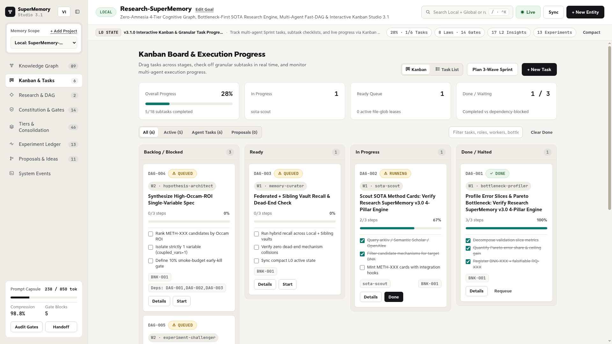
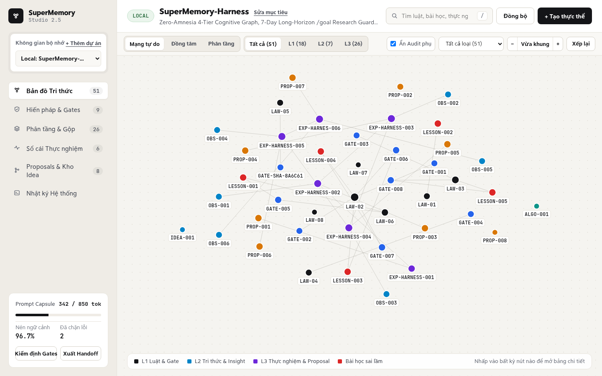
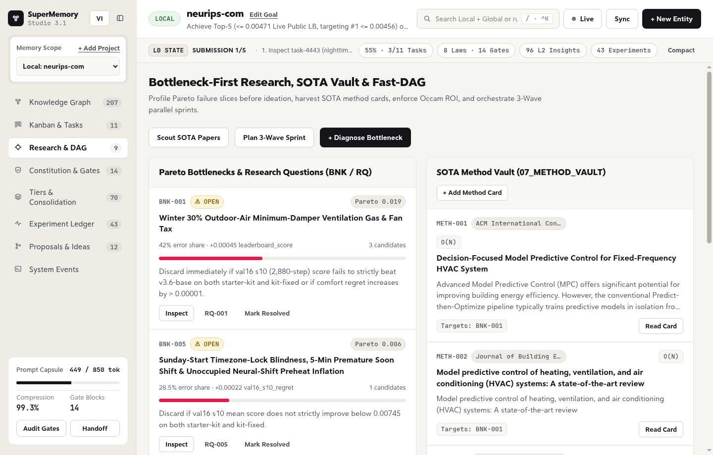
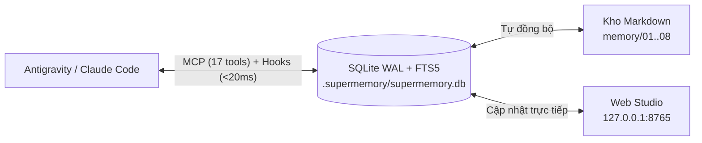

# SuperMemory

**[English](README.md)** · **[Tiếng Việt](README.vi.md)** · **[Changelog](CHANGELOG.md)**

Đồ thị bộ nhớ SQLite + Markdown, kho bài báo nghiên cứu (`arXiv` / `Semantic Scholar` / `OpenAlex`), chốt chặn code `PreToolUse`, và giao diện Web Kanban cục bộ cho **Antigravity CLI** và **Claude Code**. Thuần Python `>= 3.10` (`0` thư viện ngoài).

| Bảng Kanban & Tiến độ Subtasks | Đồ thị Tri thức (200+ Nodes) |
| :---: | :---: |
|  |  |
| **Chẩn đoán Bottleneck & Kho SOTA** | **Sổ cái Thực nghiệm & Đọc Toán LaTeX** |
|  |  |

---

## 1. Cài đặt

```bash
curl -fsSL https://raw.githubusercontent.com/vtnguyen04/research-supermemory/main/install.sh | bash
```

Hoặc cài qua `uv`:

```bash
uv tool install git+https://github.com/vtnguyen04/research-supermemory.git
supermemory install-plugin
```

Lệnh `supermemory install-plugin` tự động cài vào cả hai môi trường:
- **Antigravity CLI** (`~/.gemini/config/plugins/supermemory`)
- **Claude Code** (`~/.claude/settings.json` + MCP server `supermemory_graph` trong `~/.claude.json` + 9 skills + 8 subagents)

---

## 2. Sử dụng nhanh

```bash
# 1. Khởi tạo trong thư mục dự án
cd /path/to/project
supermemory init . --name "MyProject" --max-lines 300

# 2. Mở giao diện Web Studio (http://127.0.0.1:8765)
supermemory ui

# 3. Tìm kiếm tri thức trên Local + Global + các dự án cùng máy
supermemory recall "rollout drift" --siblings

# 4. Ghi nhận điểm nghẽn (Bottleneck) & tìm bài báo SOTA lưu vào memory/07_METHOD_VAULT/
supermemory bottleneck diagnose --title "Long-horizon drift" --error-share 58 --ceiling-gain 0.09
supermemory scout search "model predictive control latent rollout" --bottleneck BNK-001 --save-top 2

# 5. Kiểm tra CodeGates hoặc xuất file bàn giao giữa các Agent
supermemory audit
supermemory handoff
```

---

## 3. Kiến trúc & Thư mục Lưu trữ



| Đường dẫn | Chức năng |
| :--- | :--- |
| `.supermemory/supermemory.db` | Cơ sở dữ liệu SQLite WAL + FTS5, checklist Kanban, khóa file DAG và cache bài báo. |
| `~/.supermemory/global/` | Bộ nhớ chung xuyên dự án và danh sách các workspace trên máy. |
| `memory/01_ACTIVE_STATE.md` | Mục tiêu hiện tại, tiến độ và các điểm nghẽn đang mở (`< 150` dòng). |
| `memory/02_CONSTITUTION_AND_LESSONS.md` | 8 Luật cốt lõi (`LAW-01`..`08`), bài học đã gộp và danh sách `CodeGates` (`< 200` dòng). |
| `memory/04_PROPOSALS/` | Các đề xuất OpenSpec (`PROPOSED` -> `DESIGNED` -> `IMPLEMENTING` -> `AUDITED` -> `ARCHIVED`). |
| `memory/07_METHOD_VAULT/` | Thẻ phương pháp chắt lọc từ bài báo SOTA (`METH-XXX.md`). |
| `memory/08_BOTTLENECKS/` | Phân khúc lỗi định lượng (`BNK-XXX.md`) và câu hỏi nghiên cứu (`RQ-XXX`). |
| `AGENTS.md` / `CLAUDE.md` | File rule gọn nhẹ (`< 400` tokens) dùng chung cho Antigravity, Claude Code (`@AGENTS.md`) và Codex. |

---

## 4. Bảng lệnh CLI & MCP Tools

| Lệnh CLI | MCP Tool tương ứng | Tác dụng |
| :--- | :--- | :--- |
| `supermemory init` | `init` | Khởi tạo `.supermemory/`, 8 Luật, CodeGates mặc định và `AGENTS.md` / `CLAUDE.md`. |
| `supermemory status` | `status` | Xem tóm tắt trạng thái dự án (`< 850` tokens). |
| `supermemory recall "<q>"` | `recall` | Tra cứu bộ nhớ 2 bước (`compact=True` lấy danh mục -> mở chi tiết theo `node_id`). |
| `supermemory bottleneck` | `diagnose_bottleneck` | Ghi nhận/đóng điểm nghẽn (`BNK-XXX`) và tính điểm Occam ROI. |
| `supermemory scout` | `scout_sota` | Tìm bài báo trên arXiv, Semantic Scholar, OpenAlex và lưu thẻ `METH-XXX`. |
| `supermemory proposal` / `idea` | `manage_proposal` / `propose_idea` | Tạo đề xuất, cập nhật checklist Kanban hoặc đánh dấu hướng cụt (`REJECTED`). |
| `supermemory orchestrate` | `orchestrate` | Lập kế hoạch chạy đa Agent 3 đợt và khóa vùng file (`locked_globs`). |
| `supermemory exp` | `log_experiment` | Ghi kết quả thực nghiệm đơn biến và tự tính chênh lệch với baseline. |
| `supermemory learn` / `gate` | `record_lesson` / `add_gate` | Lưu bài học sửa lỗi kèm chốt chặn `PreToolUse` (regex, số dòng, AST, SHA-256). |
| `supermemory checkpoint` | `checkpoint` | Đồng bộ tự động 1 lệnh: lưu `insights` (`OBS`), tạo/tick subtask Kanban và cập nhật `L0`. |
| `supermemory audit` | `audit_gates` | Quét toàn bộ dự án theo các CodeGates đang bật. |
| `supermemory ui` | *(Skill: `/supermemory-ui`)* | Mở Web Studio quản lý Kanban, Đồ thị & Nghiên cứu (`127.0.0.1:8765`). |
